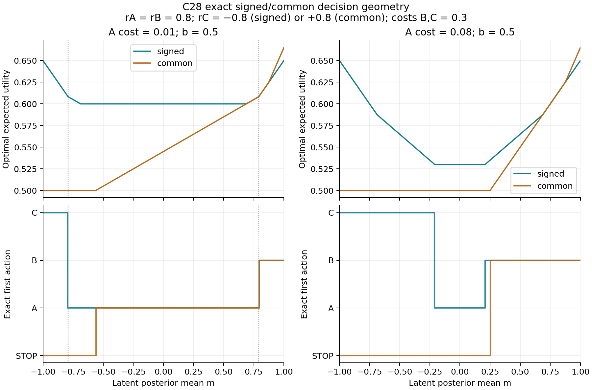
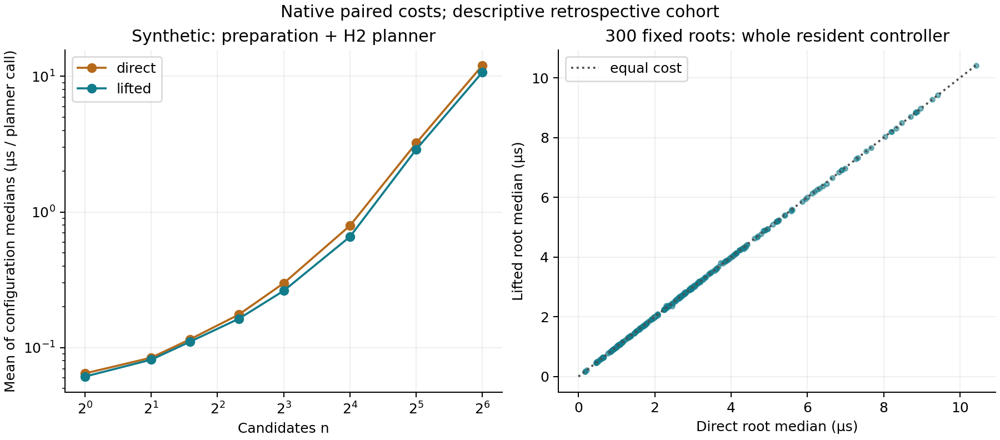

# Quartz C28 — posterior의 행동 경계와 분모를 소거한 H2 Bellman 계산

이 보고서는 사용자 SSOT `87c15dc828d6eea519c219fd8a412fa21dfc464d`에서 직접 분기한 C28-DG 연구의 결과다. 이론 R01–R10을 먼저 수행하고 코딩 C01–C10을 이어 수행했다. 과학 코드와 측정의 검토 기준은 C08 `f791e96e651d1849df601dcd7b98c18bcc3fa082`이며, 독립 코드 검토와 통합 기록은 C09 `1688ea6164db6e11d8ceca3634d45f269cd66303`에 있다. 최종 전달 커밋은 이 보고서를 포함한 Git 이력 및 외부 게시·복원 영수증으로 식별한다.

이번 범위에서 구한 것은 **posterior가 변할 때 실제 계산 행동이 바뀌는 조건**, **같은 정보량이 서로 다른 계산 가치를 갖는 명시적 구성**, **정확한 H2 값을 보존하는 계산식과 실제 비용 비교**다. 합성 planner에서는 시간 절감을 관측했지만, 실제 게임 전체 경로의 속도 이득은 입증하지 못했다. Quartz의 더 넓은 목표인 실제 계산 예산 아래의 게임 성능 개선은 계속 열려 있다.

## 1. 결론과 근거 상태

| 주장 | 결과와 범위 | 근거 상태 |
|---|---|---|
| Signed latent law의 정규화, 주변분포 보존, posterior 갱신 | 명시한 유한 모형에서 유도 | derived |
| H1 행동 유지 조건과 기준 H2 행동 경계 | 고정된 incumbent·후보·모형·비용에서 정확; 기준 예의 경계는 ±19/24 | derived, numerically checked |
| 같은 mutual information이면 같은 계산 가치를 갖는가 | 아니며, common/contrast 구성으로 값과 행동의 차이를 보임 | derived, numerically checked |
| Lifted H2와 직접 Bayes H2의 동등성 | 대수적으로 정확하고 native/독립 world oracle과 일치 | derived, implementation-verified |
| 합성 계산 시간 | 160개 고정 조건의 평균 시간이 2.101538 μs → 1.870137 μs | numerically checked; 고정 조건 기술통계 |
| 실제 게임의 경로와 비용 의미론 | 300개 루트에서 행동·질의·효용·청구 노드 불일치 0 | implementation-verified |
| 게임 전체 속도 이득 | 평균 차이 0.26 ns; 의미 있는 이득 입증 안 됨 | not established |
| 게임에서 학습한 signed dependence의 효용 | 이번 호환성 실험은 공통 양의 loading 0.75 사용 | untested |
| Gomoku P2, 인지 P3, TT 기하·물리적 동등성 | 이번 결과로 해결하지 않음 | unresolved |

일반적인 유한 horizon POMDP의 piecewise-affine 구조는 기존 문헌의 결과다. C28은 그것을 새로운 일반 정리로 주장하지 않으며, Quartz의 실제 terminal/관측/비용 계약에서 식을 다시 유도하고 구현했다. [이론 원문](theory/SIGNED_LATENT_AND_LIFTED_BELLMAN.md), [문헌 전이 검토](theory/R02_LITERATURE.md), [독립 수학 심사](theory/R06_INDEPENDENT_REVIEW.md)가 세부 근거다.

## 2. 정의와 계산 문제

후보 효용은 $U_i\in\{0,\tfrac12,1\}$, 검증된 incumbent는 $b\in[0,1]$, 남은 후보 집합은 $S$, 질의 비용은 고정된 $d_i\ge0$다. 질의는 해당 효용을 정확히 공개하고, 이미 질의한 후보는 다시 질의하지 않는다. 추가 질의는 최대 두 번이며, STOP에서는 **정확히 알려진 후보만 배치**한다. 비용과 값은 정규화된 효용 단위다. 이 설정은 잡음 있는 평가나 미검증 후보의 posterior mean에 따른 배치를 아직 포함하지 않는다.

각 후보의 기준 분포 $p_i$, 평균 $\mu_i$, 지지집합에서의 최대 편차 $s_i$에 대해

$$
f_i(u)=\frac{u-\mu_i}{s_i},\qquad t_{iu}=r_i f_i(u),\qquad |r_i|<1
$$

로 둔다. Point mass와 영확률 원자의 feature는 0으로 정의한다. 잠재변수 $Z=\pm1$의 posterior 평균을 $m=E[Z\mid h]$라 하면

$$
P_m(\mathbf u)=\frac{1+m}{2}\prod_i p_i(u_i)(1+r_i f_i(u_i))
+\frac{1-m}{2}\prod_i p_i(u_i)(1-r_i f_i(u_i)).
$$

$\sum_u p_i(u)f_i(u)=0$이므로 각 성분이 정규화되고, $m=0$에서 모든 주변분포가 정확히 $p_i$로 유지된다. 지원되는 관측 $U_i=u$에 대해서는

$$
q_i(u\mid m)=p_i(u)(1+m t_{iu}),\qquad
m' = \frac{m+t_{iu}}{1+m t_{iu}}.
$$

$|r_i|<1$이 분모의 양성을 보장한다. 영확률 관측은 유효한 posterior 갱신으로 처리하지 않는다. $m=\pm1$은 잠재상태가 확정된 경계이며 조건부 독립성이 복원된다.

이 모형의 off-diagonal covariance는

$$
\operatorname{Cov}(U_i,U_j\mid m)
=r_i r_j\delta_i\delta_j(1-m^2),\qquad
\delta_i=\frac{\operatorname{Var}_{p_i}(U_i)}{s_i}
$$

이고, point mass에서는 $\delta_i=0$이다. 따라서 세 쌍 covariance의 곱은 항상 비음수다. 엄격한 양수라는 결론에는 $|m|<1$, 세 loading과 세 분산이 모두 0이 아니라는 조건이 필요하다. 독립 심사에서 이 경계조건 누락을 찾아 수정했다. 이 제한은 세 쌍이 모두 엄격히 음의 상관인 구조를 이 단일 잠재인자 모형으로 표현할 수 없다는 뜻이며, 일반적인 joint posterior에 대한 불가능성은 아니다.

## 3. 행동을 바꾸는 posterior와 정확한 H2 식

양의 부분을 $[x]_+=\max(0,x)$라 하고

$$
\alpha_i(b)=\sum_u p_i(u)[u-b]_+-d_i,
\qquad
\beta_i(b)=\sum_u p_i(u)t_{iu}[u-b]_+
$$

로 정의한다. H1에서 후보 $i$의 순증분은 $\alpha_i+m\beta_i$다. 현재 선택 $k$와 경쟁 행동 $j$ 사이의 격차를 $\gamma_{kj}$라 하면, $m\to m+\Delta m$ 뒤에도 $k$를 유지하는 조건은 각 경쟁 행동과 STOP에 대해

$$
\gamma_{kj}+(\beta_k-\beta_j)\Delta m\ge0
$$

가 성립하는 것이다. 등호에서는 사전에 정의한 우선순위를 적용한다. 이 식은 **같은 $b,S,p,r,d$**에서의 증명이다. 관측으로 incumbent나 후보 집합이 달라진 뒤에 같은 certificate를 그대로 사용하지 않는다.

H2는 첫 관측 뒤 incumbent $b_u=\max(b,u)$를 갱신해야 한다. 직접 Bayes식은 첫 질의의 기대 개선에서 비용을 빼고, 각 관측의 확률로 H1 최적 continuation을 가중한다. 양의 분모를 max 안으로 곱하면 다음의 정확한 식을 얻는다.

$$
\boxed{
K_i=\alpha_i(b)+m\beta_i(b)
+\sum_u p_i(u)\max\!\left(0,\max_{j\in S\setminus\{i\}}
\left[(1+m t_{iu})\alpha_j(b_u)+(m+t_{iu})\beta_j(b_u)\right]\right)
}
$$

$$
V_2=b+\max\left(0,\max_{i\in S}K_i\right).
$$

근사나 closure를 새로 도입한 식이 아니다. Bayes posterior의 정규화 분모를 기대값의 관측 확률과 대수적으로 소거했다. 다만 이것만으로 속도가 빨라진다는 결론은 나오지 않는다. 직접 Bayes식도 관측마다 한 번 계산한 posterior를 모든 두 번째 후보에 재사용할 수 있기 때문에, 두 구현 모두 같은 affine coefficient cache를 사용하도록 비교했다. 둘의 후보 수에 대한 시간복잡도는 $O(|S|^2)$로 같다.

고정된 상태에서 유한 contingent plan의 값은 $m$에 affine이고 최적값은 그 상한이다. 이 사실은 value의 convex piecewise-affine 성질을 준다. 하지만 convexity만으로 첫 행동의 최적 영역이 연결되어 있다고 결론 내릴 수는 없다. C28은 이 특수 모형에서 비연결 영역의 존재 예를 제시하지 않았으며 그런 존재 주장을 하지 않는다.

## 4. 정보량과 계산 가치가 갈리는 구성

$A$는 $\{0,\tfrac12\}$, $B,C$는 $\{0,1\}$에 각각 균등분포를 갖고 $b=\tfrac12$, $m=0$로 둔다. $A$는 incumbent 자체를 개선하지 못하므로 먼저 질의할 가치가 있다면 정보의 후속 사용에서 나온다. $r_A=r_B=r$이고 common 모형에서는 $r_C=r$, contrast 모형에서는 $r_C=-r$다. 비용은 $c_A=c,d_B=d_C=d$, $x=\tfrac14-d$, $y=r^2/4$로 둔다.

모든 첫 행동을 비교한 점수는

$$
\begin{array}{c|cc}
 & K_A & K_B=K_C\\\hline
\mathrm{common}&-c+\tfrac12([x+y]_++[x-y]_+)&x+\tfrac12[x-y]_+\\
\mathrm{contrast}&-c+[x+y]_+&x+\tfrac12[x+y]_+
\end{array}
$$

이고 STOP의 점수는 0이다. 따라서 $A$가 유일한 최적 첫 행동인 영역은

$$
\mathrm{common}:\quad 2c+|x|<y,
\qquad
\mathrm{contrast}:\quad
c<\min\left(x+y,\frac{y-x}{2}\right).
$$

등호의 행동은 완전 점수표와 STOP→A→B→C 순서를 사용한다. $r=0.8,d=0.3$인 두 비용 예가 이를 직접 보여준다.

| 모형 | A 비용 | 최적 첫 행동 | 비용을 포함한 최적값 $V_2$ |
|---|---:|---|---:|
| Product, $r=0$ | 0.01 | STOP | 0.500 |
| Common | 0.01 | A | 0.545 = 109/200 |
| Contrast | 0.01 | A | 0.600 = 3/5 |
| Common | 0.08 | STOP | 0.500 |
| Contrast | 0.08 | A | 0.530 = 53/100 |

Common과 contrast는 $C\mapsto1-C$라는 전단사로 연결되므로 $I(A;(B,C))$가 같다. 실제 값은 약 0.284656509301053 nats이며, 같다는 사실은 수치 근사에 의존하지 않고 전단사로 증명된다. 하지만 같은 변환이 효용이 높은 쪽을 바꾸므로, 정보가 후속 행동의 어느 쪽을 지지하는지가 달라진다. 이것이 계산 가치 차이의 원인이다. 동일한 payoff 문제에서 정보의 Blackwell 순서를 뒤집는 반례로 해석하면 안 된다.

Contrast 기준 예에서 $c_A=0.01$을 고정하고 $m$을 움직이면

$$
\pi_2(m)=
\begin{cases}
C,&m<-19/24,\\
A,&-19/24\le m\le19/24,\\
B,&m>19/24.
\end{cases}
$$

경계에서 A와 해당 target의 순증분은 $13/120$으로 같고, A의 우선순위로 경계점을 포함한다. $\pm11/16,\pm7/8$의 내부 kink와 첫 행동 변경 경계는 서로 다른 대상이다. Posterior 변화나 entropy 감소만 세는 것보다 **어느 행동 격차를 넘었는가**를 확인해야 하는 이유가 이 예에서 구체적으로 드러난다.

위 그림의 상단은 질의 비용을 포함한 net value다. 하단은 유리수 격자에서 정확히 계산한 선택이며, 선의 픽셀 위치가 경계 증명을 대신하지 않는다. 왼쪽 점선은 $\pm19/24$를 표시한다. 원본 SVG와 정확한 plot data도 같은 디렉터리에 있다.

## 5. 구현과 검증 범위

새 구현은 [Rust binary source](../../../src/bin/quartz_c28_action_geometry.rs), [Python tests](../../../tests/test_c28_action_geometry.py), [campaign runner](coding/c28_campaign.py)다. C26 core, TicTacToe, 기존 binary, Cargo manifest/lock, 모델, 300개 source root는 변경하지 않았다. 작업 시작 때 진행 중이던 별도 C27 worktree도 쓰거나 정리하지 않았다.

Native synthetic API는 후보 0–64개, H1/H2, signed loading, zero support, point mass를 처리한다. Native game bridge는 실제 `GameState`에서 고정 seed의 네 번 rollout, 최초 exact verification, posterior 갱신, H2→H1 질의 및 최종 선택을 수행한다. Prior를 최초 검증 전에 고정했으므로 그 결과가 원래 분포를 제대로 조건화한다. 검증기는 별도 Python board/minimax와 complete joint worlds를 사용하며, oracle label을 native runtime 입력에 보내지 않는다.

Native 선택은 최대 순증분이 $10^{-12}$ 이하이면 STOP이고, 그렇지 않으면 최대점수에서 $10^{-12}$ 안에 있는 최소 action id를 택한다. API의 `value`는 이 epsilon 선택의 값으로 바꾸지 않고 원래 최대값을 보고한다. 점수 검증은 절대 $5\times10^{-12}$, 상대 0으로 고정했다.

| 실제 검증 | 결과 | 한계 |
|---|---|---|
| R07 유리수 중심 exact/diagnostic 검사 | 19,252 assertions; 원격 exit 0 | 보편 명제는 별도 유도로 지지하며, MI 로그 진단은 부동소수점 |
| 독립 수학 checker | 120 rational models, 290 비용 사례, 193 belief states | 동일 문제의 별도 bounded check |
| Rust scoped tests | 15개 통과; 80개 상태에서 score 640개와 value 320개 비교 | 전체 repository test 결과가 아님 |
| Python suite | 17개 통과, exit 0 | C28 native/protocol/과학 검증 범위 |
| C06 raw synthetic verification | 108개, 최대 residual $2.22\times10^{-16}$ | 정해진 유한 입력군 |
| C07 실제 game verification | 300루트, 실제 decision 210개, 최대 residual $1.67\times10^{-16}$ | 이미 관측한 retrospective cohort |
| C08 finite precision | 160개 조건에서 choice 차이 0, 최대 score 차이 $2.22\times10^{-16}$ | 넓은 후보 수의 비교는 두 native 계산식; 작은 모형에 exact-world oracle 적용 |

전체 300루트 중 107개에서 planner가 실행되었고, 193개는 최초 알려진 효용이 1이라 바로 종료했다. 추가 질의가 1개인 루트는 4개, 2개인 루트는 103개였다. 총 210개 질의/decision에서 H2 107개와 H1 103개를 확인했다. Initial/final action, query sequence, realized utility, charged nodes의 direct/lifted 불일치는 모두 0이었다. 모든 300루트에서 독립 minimax·부호·비용을 확인했고, 실제로 방문한 210개 decision은 완전 world oracle과 비교했다. 이 210개는 모두 실제 질의를 택했다. 미포화 상태에서 점수 때문에 명시적으로 STOP하는 경우의 검증은 합성 구성과 단위 검사에 근거하며, 이 game cohort에서 관측했다고 주장하지 않는다.

독립 C09 검토 상태: **PASS_SCOPED — blocking 수학·구현·집계 결함 없음; 낮은 심각도의 evidence 표현 정정 1건 적용**. 세부 근거와 제한은 [검토 보고서](evidence/C09_REVIEW.md)에 보존한다.

## 6. 계산 시간: 합성 계산의 절감과 전체 게임의 동률

하드웨어는 AMD Ryzen 9 5900X이고 native process는 논리 CPU 11에서 단일 thread로 실행했다. 다른 사용자 작업이 있는 환경이므로 독점 하드웨어 측정은 아니다. Rust/Cargo 1.99.0, `--locked --offline`, 별도 target directory를 사용했다.

Synthetic은 매 iteration마다 law/coefficient preparation 비용을 포함했고, 게임은 cues/model, initial solve, belief/cache, posterior, planning, 추가 exact queries, 최종 선택까지 포함했다. JSON transport·parse/validation·history replay·serialization은 명시한 resident-controller 측정 경계 밖이다. 두 방법의 순서를 반복마다 교대했다. Synthetic은 조건마다 11회, game은 루트마다 31회 측정했고 warmup은 각각 3쌍이다. Synthetic의 total ns는 iteration 수로 정확히 한 번 나누었다.

아래 값은 **각 조건/루트 안의 중앙값을 구한 뒤 그 중앙값들을 평균한 것**이다. 비율은 그 두 평균의 비다. 동결한 축의 곱은 160개 grid entry지만, n=1에서는 두 loading-pattern 표지가 같은 문제를 만들므로 구별되는 request payload는 150개다. 사후에 중복 조건을 제거해 평균 가중치를 바꾸지 않았으며, 160개를 서로 독립적인 통계 표본으로 해석하지 않는다.

| 범위 | Direct | Lifted | Lifted/Direct |
|---|---:|---:|---:|
| Synthetic 160조건 | 2.101538 μs | 1.870137 μs | 0.889890 |
| Synthetic n=16, 20조건 | 0.792881 μs | 0.657316 μs | 0.829022 |
| Synthetic n=64, 20조건 | 12.060294 μs | 10.731616 μs | 0.889830 |
| Game 300루트 전체 | 2.954927 μs | 2.954667 μs | 0.999912 |
| Game, planner 활성 107루트 | 4.441925 μs | 4.440841 μs | 0.999756 |
| Game, planner 미실행 193루트 | 2.130528 μs | 2.130725 μs | 1.000092 |

Synthetic 전체에서는 약 11.01% 낮은 시간이 관측되었다. 반면 게임 전체 차이는 0.26 ns, 활성 subgroup의 차이도 약 1.084 ns다. 이 수치를 실제 게임 속도 향상으로 승격하지 않는다. Planner를 실행하지 않는 루트가 많다는 사실은 관련되지만, 활성 subgroup도 거의 같기 때문에 그것만을 원인으로 단정하지 않는다. 별도 profiling으로 비용 항의 기여를 측정한 것은 아니다.

또한 노드 가격 $1/1024$는 효용/노드 단위이고, 측정 ns를 임의로 효용으로 바꾸어 net improvement를 만들지 않았다. 동일한 게임 행동에서 실현 효용은 동일하다. 이 자료는 새로운 TEST나 Elo 결과가 아니며, 같은 결과를 다시 측정하거나 hyperparameter를 바꿔 원하는 부호를 찾지 않았다.

독립 C09 검토에서 evidence 표현 한 곳을 바로잡았다. Benchmark의 300개 request summary는 측정 밖에서 별도로 실행해 비교한 값이다. 9,300쌍의 timed repetition에서는 반환 summary를 `black_box`로 소비하고 시간만 기록했으므로, 그 모든 summary를 개별 비교했다고 주장하지 않는다. Timed path의 의미론은 같은 seed·input을 사용하는 결정적 코드와 별도 trace 검증에 근거한다. 파생 JSON key와 설명을 수정했고 원시 측정·수치 집계·native source/binary는 바꾸지 않았다.

[원시 측정·hash·환경](evidence/c08_benchmark/metadata.json), [전체 집계](evidence/c08_benchmark/summary.json), [조건 수·정밀도·활성 subgroup](evidence/c08_benchmark/analysis.json)에 재현 근거가 있다. 총 paired timing samples는 synthetic 1,760쌍, game 9,300쌍이다. 모든 source/input/binary는 실행 전후 byte-identical이었다.

## 7. 원래 연구 동기와 이번 결과의 연결

원동기 watchdog은 최초 도달 가능한 commit `15f3a1986a00d548d3da56dab8233b336e931aee`, legacy 도입 `3bcaa435b6bdca2f821f8990230ea05ddf251a2f`, 원 논문 PDF와 PRD를 실제로 읽어 수행했다. 문서의 내부 날짜와 Git 최초 등장 시점은 구분했다. [역사 추적 기록](ORIGIN_DRIFT_WATCHDOG.md)에 source identity와 원문 위치가 있다.

보존한 핵심은 KL/Gibbs 기반 가치 구조, 계산 비용을 뺀 downstream decision gain, 그리고 실제 CPU 예산 아래의 게임 의사결정이다. 상관을 단순히 불확실성 수치로 추가하는 대신 **행동 간 대비와 질의 선택**으로 연결한 것이 이번 이론의 직접적 기여다. FOCUS/EXPAND/MERGE/STOP의 원래 구현과 P2/P3 목표를 작은 finite example의 성공으로 대체하지 않았다.

원 PDF의 “독립 가정은 항상 보수적”이라는 범위는 수정해야 한다. 예를 들어 두 값의 분산이 각각 1이고 상관이 −0.5이면 차이의 분산은 $1+1-2(-0.5)=3$이며, 독립 가정의 값은 2다. 따라서 covariance 부호 없이 보수성을 보장할 수 없다. 이는 원래 동기를 폐기하는 반례가 아니라, action contrast를 정확히 다루기 위한 조건 교정이다.

이번에 닫힌 것은 signed 유한 모형의 구성·경계·H2 계산 동등성과 동결한 구현 실험이다. 일반적인 signed game law의 학습, 잡음 있는 계산행동, 실제 같은 시간 예산의 승률 개선은 열려 있다. TT geometry, RG/Wick/criticality 같은 더 큰 해석에도 새 물리적 동등성을 부여하지 않는다.

## 8. 실패 보존, 전달과 다음 연구

실제로 발견한 수학적 문제는 covariance의 엄격한 양성 조건 누락이었다. 독립 checker의 첫 실행에는 `Fraction(0)` 대신 정수 0을 사용한 산술 오염이 있었고 수정 전 기록도 남겼다. Code 단계에서는 과학 계산의 실패와 다음 주변 오류를 분리했다: C27 source가 별도 worktree에 있다는 사실을 놓친 receipt lookup, missing-native의 nonzero exit를 특정 숫자로 잘못 기대한 wrapper, raw test log/SVG의 공백을 source formatting으로 검사한 게시 helper. 모두 원자료를 보존하며 좁게 수정했다. Matplotlib의 Axes3D 경고는 2D 산출물의 생성·시각 검토를 막지 않았다.

각 단계의 실제 산출물을 Git으로 게시하고, 누적 archive의 내용·실행권한 및 원격 HEAD를 확인한 다음 이전 C28 중복 archive/bundle을 제거했다. 원본 역사 bundle과 최신 누적 history bundle이 이전 모든 단계 commit을 보존한다. C08 시점에는 이 보존본만으로 1,108,516,250 bytes의 tracked payload와 파일 2,875개, 단계 18개를 실제 복원·검사했다. [복원 영수증](evidence/C09_RESTORE_C08.json)에 정확한 검증 범위가 있다. 실제로 측정한 629,568-byte release executable도 별도로 보존하고 SHA256을 대조했다. [실행파일 identity](evidence/C09_MEASURED_BINARY.json)를 통해 향후 rebuild에만 의존하지 않고 측정 대상을 확인할 수 있다. 최종 C10 게시 후에는 같은 복원 절차를 최종 HEAD에 다시 적용하고 외부 `FINAL_RESTORE_AUDIT.json`으로 기록한다. Dropbox 경로에 썼다는 사실만으로 클라우드 동기화 완료를 주장하지 않는다.

다음 추천 범위는 **잡음 있는 계산 결과와 정직한 terminal decision**이다. 현재 exact reveal/known-only STOP 조건을 풀어야 실제 반복 평가의 계산 가치로 진행할 수 있다. 단순한 posterior-change 수치나 추가 timing 반복을 목적 자체로 삼지 않는다. 다음 모형에서는 관측 channel $P(Y\mid U_i)$, 갱신되는 joint belief, STOP의 $\max_i E[U_i\mid h]$, 실제 시간 비용을 먼저 고정하고, 작은 finite-world oracle로 이론–구현의 대응을 검증한 뒤 실제 GameState로 연결한다. 구체적인 다음 R01–R10/C01–C10 작업 계약은 [CONTINUATION.md](CONTINUATION.md)에 있다.

## 핵심 원전

1. Kaelbling, Littman, Cassandra (1998), [Planning and acting in partially observable stochastic domains](https://people.csail.mit.edu/lpk/papers/aij98-pomdp.pdf), 특히 §4.1과 §4.4. 유한 horizon plan과 piecewise-linear/convex value의 기준 문헌.
2. Hay, Russell, Tolpin, Shimony (2012), [Selecting computations: Theory and applications](https://aima.eecs.berkeley.edu/~russell/papers/uai12-meta.pdf), Definition 3. STOP의 posterior-mean 배치와 C28 known-only 배치의 차이를 명시적으로 구분했다.
3. de Oliveira (2018), [Blackwell’s informativeness theorem using diagrams](https://henriquedeoliveira.com/wp-content/uploads/2020/12/blackwells-informativeness-theorem-using-diagrams.pdf). 정보 비교에서 상태와 payoff 문제를 고정해야 하는 맥락.
4. Rauh et al. (2017), [Coarse-graining and the Blackwell order](https://arxiv.org/pdf/1701.07602). Mutual information과 decision value를 구별하는 원전 사례. 정확한 적용 범위는 R02 문헌 기록에 있다.
