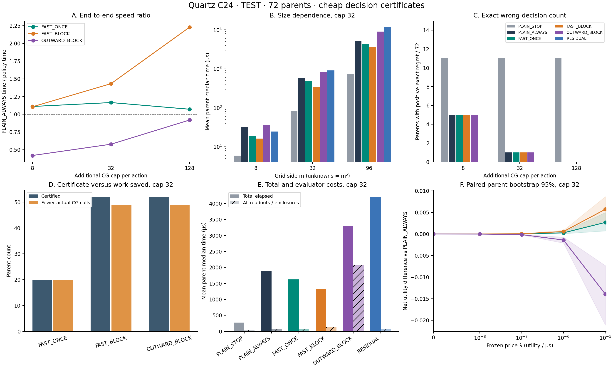

# Quartz C24 — 저비용 엄밀 인증

[최종 연구 보고서](REPORT.md) · [이론10단계](THEORY.md) · [코딩10단계](CODING.md) · [완전한 유도](theory/DERIVATION.md) · [독립 검토](review/C09_REVIEW.md) · [재현 방법](REPRODUCE.md) · [다음 단계 제안](NEXT_STAGE.json)

새 TEST72에서 FAST_BLOCK은 같은 예산의 PLAIN_ALWAYS와 정확 효용이 같고 전체 시간30.1515%, CG 호출44.8436%를 줄였다. 고정 가격1e-6utility/us에서 PLAIN_STOP 대비 순효용은 음수다. 두 결과를 함께 보존한다. 원래 프로젝트P2/P3/P4와 임의 동적 범위CG는 이번 결과로 확립하지 않는다.

[기계 판독 주장 상태](CLAIMS.json), [측정 요약](evidence/C24_TEST_SUMMARY.json), [파일 identity](ARTIFACTS.json), [단계별 게시 기록](STAGE_PUBLICATIONS.json)을 제공한다. C25는 제안이며 아직 실행하지 않았다.
