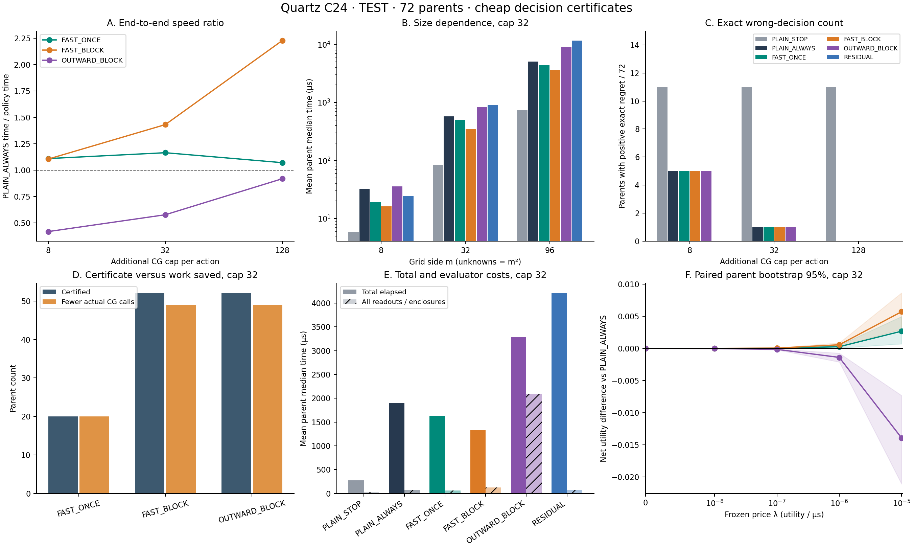

# Quartz C24 — 외향 반올림 스칼라 경계로 인증 비용 줄이기

연구 ID: **QUARTZ-GENERAL-24-ROUNDING-AWARE-CHEAP-CERTIFICATES**
날짜: **2026-11-23, Asia/Seoul**
선행 연구: C23, commit `a4417b081037c4d5b49976ddcaeaa3f0771773b2`
실험 결과 게시 commit: `df34b7ae1b867f4917c2d302ea97aca40cc55077`
연구 branch: `research/quartz-general-c24-cheap-certificates-20261123`

## 판정

C24는 **조건부로 엄밀한 저비용 response enclosure를 유도하고, 실제 Rust 구현과 새로운 TEST 자료에서 검증했다.** 주 예산에서 FAST_BLOCK은 PLAIN_ALWAYS와 정확한 의사결정 효용을 유지하면서 전체 시간을 **30.1515%**, CG 호출을 **44.8436%** 줄였다. 기존 OUTWARD_BLOCK과는 모든 TEST 문제·예산 조합에서 같은 선택·인증·반복 일정을 보였지만, 평가 비용은 **93.8645%** 줄었다.

고정 가격 $\lambda=10^{-6}\ {\rm utility}/\mu{\rm s}$에서는 FAST_BLOCK의 PLAIN_STOP 대비 순효용 차이가 여전히 음수다. 따라서 이번 성과는 같은 계산 예산의 일반 풀이에 붙이는 인증을 실용적인 비용으로 만든 것이다. 추가 계산의 구매 여부까지 최적화한 결과는 아니다. 알려진 극소 RHS의 거짓 성공은 명시적 지원 범위 거부로 해결했으며, 임의 동적 범위를 지원하는 CG를 완성했다고 주장하지 않는다.

이론 R01–R10과 코딩 C01–C10의 산출물은 [THEORY.md](THEORY.md), [CODING.md](CODING.md)에 기록했다. C09 독립 검토는 **Looks good**, 현재 범위의 미해결 blocker 없음이다. C25는 [NEXT_STAGE.json](NEXT_STAGE.json)에 제안 상태로 인계했으며 실행하지 않았다.

## 1. 문제와 보장하려는 양

연구 대상은 무차원 유한 격자 SPD 문제다.

$$
A=I+\rho L_D,\qquad n=m^2,\qquad
1=\alpha\le\lambda(A)\le\beta=1+8\rho .
$$

$L_D$는 외부 값을 0으로 놓는 five-point Dirichlet stencil이며, 대각 4와 내부 인접점 계수 $-1$을 사용한다. $A$는 이산 행렬 자체로 정의했다. 격자 간격을 줄이는 연속체 극한이나 물리 단위를 갖는 PDE의 수렴 주장은 이번 범위에 없다. 물리 상수를 자연단위로 생략한 모형도 아니다.

각 후보 $a$의 참 효용은

$$
q_a=b_a^T A^{-1}b_a,\qquad u_a=q_a/S
$$

이다. 공통 $S$는 모든 후보의 $\|b_a\|_2^2$를 덮는 정상 양의 2의 거듭제곱이고 $0\le u_a\le1$이다. 공개 입력과 정확 oracle은 분리했으며 solver에는 $b_a$, $A$, $S$만 보낸다.

저장된 임의의 iterate $x$에서

$$
P=b^Tx,\quad Q=x^TAx,\quad \ell=2P-Q,\quad
r=b-Ax,\quad D=\|r\|_2^2
$$

로 두면

$$
q-\ell=(A^{-1}b-x)^TA(A^{-1}b-x)
      =r^TA^{-1}r
$$

이고 따라서

$$
\ell+D/\beta\le q\le\ell+D .
$$

이 항등식에는 CG의 정확한 직교성이나 Galerkin 조건이 필요하지 않다. 실제 저장된 부동소수점 $x$에 대해 각 양의 구간을 올바르게 만들면 된다. 원래 항등식과 strict decision theorem은 C23에서 이어받고, 이번에는 그 구간의 계산 방법을 발전시켰다.

## 2. 새로 유도한 계산 가능한 경계

산술 전제는 IEEE binary64 round-to-nearest, gradual underflow, 고정된 순차 연산, overflow 부재다. 허용되지 않은 fast-math 재결합을 사용하지 않는다.

$$
u_{\rm fp}=2^{-53},\quad \sigma=2^{-1022},\quad
\gamma_k=\frac{k u_{\rm fp}}{1-k u_{\rm fp}},\quad
F_k=\frac{k\sigma}{1-k u_{\rm fp}} .
$$

여기서 $\sigma$는 최소 양의 **normal** 수이며 의도적으로 보수적인 절대 underflow floor다. 실험에 맞춰 고른 padding이 아니다. 상대 오차만 있는 모델을 극소 입력에 그대로 적용하지 않는다. 원시 오차 모델과 기존 dot-product 경계는 Rump의 원 논문에서 확인했고, 아래 합성식은 이 사이클에서 직접 유도했다. [Rump 2012 §2, §4](https://www.tuhh.de/ti3/paper/rump/Ru11.pdf), [Jeannerod–Rump 2013](https://www.tuhh.de/ti3/paper/rump/JeaRu13.pdf), [문헌 기록](theory/LITERATURE.md).

일반 산술로 $\widehat y$, $\widehat r$, $\widehat P$, $\widehat Q$, $\widehat D$를 계산하고

$$
B=\max|b_i|,\quad X=\max|x_i|,\quad
Y=\max|\widehat y_i|,\quad R=\max|\widehat r_i|
$$

를 구한다. $B$는 입력 검증에서 캐시하며 $X$는 공통 상태 검증 pass에서 구한다. FAST 경로는 일반 stencil/dot pass에 $Y,R$의 max reduction을 추가한다.

Stencil의 최대 9회 반올림과 순차 dot의 최대 $2n$회 반올림에서

$$
E_y=\gamma_9\beta X+F_9,\qquad
E_r=E_y+u_{\rm fp}(B+Y)+\sigma,
$$

$$
E_P=\gamma_{2n}nBX+F_{2n},
\qquad
E_Q=\gamma_{2n}nXY+F_{2n}+nXE_y
$$

를 얻는다. 마지막 $nXE_y$는 $x^TAx$로 전파되는 operator error다. 이를 빼면 계산식의 enclosure가 정당화되지 않는다.

$$
P\in[\widehat P-E_P,\widehat P+E_P],\qquad
Q\in[\widehat Q-E_Q,\widehat Q+E_Q]
$$

에서 외향 반올림으로 $[\ell_L,\ell_U]$를 만든다.

잔차의 경우 먼저 $D_0=\sum_i\widehat r_i^2$를 사용한다. $g=\gamma_{2n}$, $F=F_{2n}$일 때

$$
|\widehat D-D_0|\le gD_0+F
$$

이므로

$$
D_{0L}=\max\!\left(0,\frac{\widehat D-F}{1+g}\right),
\qquad
D_{0U}=\frac{\widehat D+F}{1-g}.
$$

또한

$$
|D-D_0|\le T,\qquad T=n(2RE_r+E_r^2),
$$

따라서 $D_L=\max(0,D_{0L}-T)$, $D_U=D_{0U}+T$다. 모든 error-budget 계산과 분모·endpoint 연산 자체도 외향 반올림한다.

정규화 **전에**

$$
q_L=\max(0,\operatorname{down}(\ell_L+D_L/\beta)),\quad
q_U=\min(S,\operatorname{up}(\ell_U+D_U))
$$

를 만든 뒤 $S$로 나눈다. 이 순서로 작은 $S$와 느슨한 중간 경계가 만드는 불필요한 overflow를 피한다. 빈 구간은 오류로 처리한다.

과거 구간과 현재 구간의 교집합을 누적하고 어떤 후보 $i$가

$$
L_i>\max_{j\ne i} U_j
$$

를 만족하면 참 효용의 유일한 최적 후보임을 인증한다. 인증되지 않으면 같은 예산의 PLAIN_ALWAYS와 같은 최종 ordinary score와 action을 반환한다. 따라서 지원 조건 아래의 보장은 **PLAIN_ALWAYS에 대한 참 효용 비열등성**이다. 모든 미래 예산에서 action이 같거나 초기 선택보다 효용이 반드시 좋아진다는 명제는 포함하지 않는다.

완전한 유도와 operation count는 [DERIVATION.md](theory/DERIVATION.md)에 있다. 두 evaluator 모두 $O(n)$이며, 이번 변화는 각 원소에서 반복하던 구간 산술을 일반 산술과 고정 개수의 외향 scalar 연산으로 바꾼 것이다.

## 3. 지원 범위와 잔차 의미론

일반 구현의 지원 범위는 $2\le m\le128$, 정수 $0\le\rho\le64$, 후보 $2\le K\le8$이다. 비영 RHS와 저장 상태에는

$$
2^{-400}\le B\le2^{100},\qquad
X\le2^{200},\qquad X\le2^{100}B
$$

를 요구한다. 영 RHS는 영 상태를 요구하며 별도로 정확히 처리한다.

C23에서 $b_{\max}=2^{-600}$인 입력은 norm 제곱의 underflow 때문에 0회 반복으로 목표 달성처럼 보였다. 실제 RED 로그로 이를 재현했고, 새 바이너리는 solver 생성 전에 `UNSUPPORTED_RHS_NORM_RANGE`로 거부한다. 지원 밖 입력을 정확하게 풀었다고 표시하지 않는다.

입력 제곱합에도 양의 dot 역산을 적용해 $B_L\le\|b\|^2\le B_U$를 구한다. 인증된 참 상대 잔차 상한은

$$
\operatorname{up}\left(
\frac{\operatorname{up}\sqrt{D_U}}
     {\operatorname{down}\sqrt{B_L}}\right)
$$

이다. $D_U/B_L$를 먼저 계산하지 않으므로 제곱비의 중간 overflow를 피한다.

`residual_relative`는 일반 계산의 추정치다. PLAIN 정책과 미인증 FAST_ONCE의 최종 일반 평가에서는 `residual_upper`, `residual_goal_met`가 명시적 null이다. FAST/OUTWARD의 최종 평가에는 실제 상한과 그것에 근거한 목표 판정이 있다. 이 차이는 출력 계약과 테스트에서 확인했다.

## 4. 실험 설계와 주 결과

새로운 144개 source parent를 사용했다. TRAIN36, CAL36, TEST72이며 36개 stratum은 $m=8,32,96$, $\rho=1,16,64$, gap wide/medium/tight/tie의 조합이다. C23와 source ID·seed가 겹치지 않는다. 정답은 정확 dyadic 제조와 별도 유리수 energy로 보존했다.

최초 4회 CG, 추가 예산 8/32/128, block8, warmup1회와 측정9회, primary FAST_BLOCK 대 PLAIN_ALWAYS, 가격과 bootstrap seed를 결과 전에 고정했다. 각 정책은 실제로 독립 실행했다. 검증용 trace와 시간 측정을 분리하고 timing에서는 전체 iterate 복사를 하지 않았다. 타이머에는 입력 검증, allocation, 초기 풀이, 모든 readout, 제어, 후속 풀이와 solver 작업공간 해제를 포함한다. JSON 처리와 offline oracle 계산은 제외한다.

측정은 기록된 Ryzen9 5900X의 단일 thread native 실행이다. 각 문제·정책의 9회 중앙값을 구한 후 72개 문제의 산술평균을 낸다. paired bootstrap은 문제 parent를 단위로 2,000회 수행했다. 아래 구간은 고정된 제조 문제 혼합에 대한 기술적 percentile 구간이며 다른 하드웨어·자연 문제 분포에 대한 보편적 성능 보장이 아니다.

### 주 예산: 추가 32회

| 정책 | 평균 parent median, μs | 양의 정확 regret /72 | 인증 /72 | 실제 조기 종료 /72 | 총 CG 호출 |
|---|---:|---:|---:|---:|---:|
| PLAIN_STOP | 273.899264 | 11 | 0 | — | 864 |
| PLAIN_ALWAYS | 1896.146681 | 1 | 0 | 0 | 7,321 |
| FAST_ONCE | 1627.621028 | 1 | 20 | 20 | 5,629 |
| **FAST_BLOCK** | **1324.430667** | **1** | **52** | **49** | **4,038** |
| OUTWARD_BLOCK | 3288.090556 | 1 | 52 | 49 | 4,038 |
| RESIDUAL | 4206.732708 | 0 | 0 | 별도 목표 | 11,831 |

인증과 실제 계산 절약을 구분했다. 마지막 예산에서 처음 인증된 경우는 인증 수에 들어가도 미실행 CG를 만들지 않는다. RESIDUAL은 재귀 잔차 $10^{-8}$, cap512의 다른 장 정확도 목표를 갖는다. 최종 인증 상한으로도 TEST72/72에서 목표를 충족했다.

FAST_BLOCK이 절약한 평균 시간은

$$
571.716014\ \mu{\rm s},\qquad
95\%\ {\rm paired\ interval}=[299.623803,865.193934]\ \mu{\rm s}.
$$

PLAIN_ALWAYS와의 평균 효용 차이는 **정확 유리수로 0**이다. 두 정책 모두 평균 regret $1.2998983391912958\times10^{-9}$, 양의 regret 사례 1개다. 전체 시간비는 1.431669이며, 시간 30.1515% 및 CG 호출 44.8436% 감소다.

FAST_BLOCK과 OUTWARD_BLOCK의 action·인증 여부·후보별 반복 수·평가 일정은 216개 TEST 문제/예산 조합 전부에서 같다. 주 예산의 평균 평가 시간은 각각 128.330833 μs와 2091.603194 μs다. 측정된 비용 차이는 이 동일한 작업 일정에서 evaluator 산술을 바꾼 효과로 설명된다.

### 예산 변화와 남은 실패

| 추가 예산 | PLAIN_ALWAYS 시간, μs | FAST_BLOCK 시간, μs | 시간비 | 두 정책의 오선택 수 /72 | FAST_BLOCK 인증 / 실제 조기 종료 |
|---:|---:|---:|---:|---:|---:|
| 8 | 708.228958 | 640.869167 | 약1.105 | 5 | 38 /20 |
| 32 | 1896.146681 | 1324.430667 | 약1.432 | 1 | 52 /49 |
| 128 | 5154.750486 | 2312.168389 | 약2.229 | 0 | 54 /54 |

이는 유한 반복 예산에 대한 비교다. $m$을 바꾼 결과는 이산 문제 크기 의존성으로 읽어야 한다.

주 예산에서 초기 선택 대비 FAST_BLOCK의 실제 효용은 11개 개선, 1개 악화, 60개 동일했다. 악화한 `c24_test_34_1`은 $m=96,\rho=64$, tight gap이며, 초기 action1이 최종 action2로 바뀌고

$$
\Delta u=-\frac{113146607888822335}{1208925819614629174706176}<0
$$

이다. 해당 결과는 인증되지 않은 fallback이고 PLAIN_ALWAYS도 같은 선택을 한다. 추가128에서는 이 사례를 포함해 전체 오선택이 0이다. 이 실패는 유한 예산의 의사결정 근사 오차이며, 거짓 인증이나 범위 밖 입력의 거짓 수렴과 구분한다.

근거: [TEST summary](evidence/C24_TEST_SUMMARY.json), [parent metrics](evidence/C24_TEST_PARENT_METRICS.json), [추가 결과 점검](evidence/C08_RESULT_AUDIT.json).

## 5. 계산할 가치와 계산을 줄이는 능력

가격은 결과를 본 후 선택하지 않았다. 주 가격에서

$$
\Delta J_{\rm FAST,STOP}
=
\overline{u_{\rm FAST}-u_{\rm STOP}}
-\lambda\,\overline{t_{\rm FAST}-t_{\rm STOP}}
=-0.0010419339760477828
$$

이고 95% 구간은

$$
[-0.0014325281379376478,\,-0.0006717026599738968]
$$

이다. 같은 예산의 PLAIN_ALWAYS 대비 시간 절약은 양수지만, 이 가격에서 평균적으로 즉시 종료보다 더 좋은 순효용을 얻지는 못했다.

평균 효용 차이를 평균 추가 시간으로 나눈 기술적 손익분기 가격은

$$
\lambda_{\rm BE}=8.183883610962888\times10^{-9}
\ {\rm utility}/\mu{\rm s}
$$

이다. 이것은 이번 표본의 설명 값이며, 학습한 threshold나 다음 연구의 유리한 primary 가격으로 바꾸지 않았다. $\lambda=10^{-8}$에서는 순효용 평균이 조금 음수이고 구간이 0을 포함한다. 개인 문제별 이득의 편차도 크다.

그림의 PNG와 PDF, 원래 figure 및 보정한 rendering code를 모두 보존했다. 보정은 비음수 가격축과 범례 공간에 한정되며 통계값은 바꾸지 않았다.

## 6. 실제 검증과 근거 상태

| 근거 상태 | 수행한 작업과 범위 |
|---|---|
| established / literature-supported | SPD energy 항등식, spectral enclosure, 원 논문의 반올림·underflow 모델 |
| derived | 합성 scalar enclosure, raw clipping, 지원 범위와 참 상대 잔차 상한, strict certificate·fallback 비열등성 |
| numerically checked | 이론77개 상태, exact stencil488개, scalar/utility containment385개, 상대 잔차77개; 독립 Wolfram 유리수 예제 |
| implementation-verified | Rust debug27/27, release27/27, release build exit0; Python10/10; 관측한 의미론적 RED→GREEN |
| implementation-verified | 부모 독립 native6 fixtures: 36정책, 666구간 검사, 69참 잔차 상한, 실제 조기 종료와 bit-identical fallback; 별도4UNIT 전체 CLI |
| numerically checked | TEST trace1,296정책, 구간28,068개, strict-optimal348개, 전체 반환 x의 fallback300개; 9개 사전지정 parent의 잔차90개/고유 vector54개 |
| numerically checked | TEST timing11,664정책, q 구간104,976개, fallback readout2,700개; 전후 입력 해시 동일 |
| independently checked | 새 reviewer가 원시 자료에서18개 정책/예산 통계와 bootstrap을 재계산; 정확 효용·정수 count 일치, 부동소수 집계 최대차 $9.09\times10^{-13}$μs |
| unresolved | 가격에 따른 추가 계산 선택, 임의 동적 범위 solver, 일반 하드웨어 성능, 실제 원 프로젝트 P2/P3/P4 및 연속체 물리 주장 |

9회 시간 반복은 독립된 새로운 문제로 세지 않았다. 참 잔차 vector의 정확 재계산은 전체 TEST의 모든 state를 대상으로 한 것이 아니라 C04에서 고정한 9개 parent와 별도 UNIT 범위다. 모든 TEST의 q enclosure와 fallback 검사는 전체를 대상으로 했다.

실패도 기록했다. R07의 최초 Python exact checker는 정수 나눗셈 경로에서 float를 섞은 구현 오류였고 Fraction matrix로 교정했다. 알려진 극소 RHS의 과거 거짓 성공, Python 검증기의 zip truncation·중복 rep·잘못된 진단 수용, exact regret를 float로 먼저 바꾸던 오류와 비용 계수 문제는 실제 RED 로그에 남겼다. 원시 cargo stdout의 끝 공백 때문에 실패한 게시 전 format check도 원본을 수정하지 않고 raw stream만 source whitespace check에서 제외한 이력으로 남겼다.

[독립 리뷰](review/C09_REVIEW.md), [독립 계산](review/C09_REVIEW_CHECKS.json), [실제 복원 결과](evidence/C09_RESTORE.json)를 함께 제공한다.

## 7. 보존·게시와 재개 가능성

각 R01–R10, C01–C10 단계마다 Git commit, 누적 변경 archive, 원격 branch의 commit readback을 남겼다. 자료를 실행 전에 고정하기 위해 C07A와 C08A 게시도 추가했다. 단계별 영수증의 최종 C10 항목은 자기 commit hash를 포함하므로 archive 바깥의 receipt에 기록한다. [단계 기록 snapshot](STAGE_PUBLICATIONS.json)은 C10 직전까지의 영수증과 이 규칙을 설명한다.

백업은 C23의 전체 최종 archive와 각 C24 누적 overlay로 구성한다. 실제 C08 복원에서 **2,148개 추적 파일, 798,260,314 bytes**가 Git commit의 blob과 모두 일치했다. TRAIN65,708,367 bytes, CAL65,633,648 bytes, TEST131,402,222 bytes의 원시 trace를 조각에서 재조립했고 원래 측정 manifest의 SHA-256과 일치했다. 최종 C10 overlay의 읽기와 전체 단계 archive checksum은 별도 최종 게시 audit으로 기록한다.

원래 개발 worktree의 상태와 12개 선행 worktree HEAD는 유지했다. 원래 THESIS/CLAIM_LEDGER/game 파일은 각각 자기 기준 HEAD와 대조했다. 현재 C24의 보호 파일도 바꾸지 않았다. Git 원격 게시와 실제 백업 파일·복원은 확인했다. **Dropbox 서버의 동기화 완료 acknowledgment는 확인하지 않았으므로 NOT_VERIFIED로 유지한다.**

핵심 identity:

| 대상 | SHA-256 |
|---|---|
| C24 Rust source | `5a7cc595c267d5337f268045d1df8bf5909093ed7920ee50293da76da94cd381` |
| 실제 측정 release binary | `2cef68fda2bdacae138efe7928531d9cfebc26bff8fbc13e895a7ad7d41f45b6` |
| TEST raw trace | `1a225dd982f6b5cd512971880340c2d7d22cf71c4d930b119914f3fe7066cd87` |
| TEST raw timing | `acfd13fa7c4bc88040d90056988e3159597aa0f5c17c48847d1ec43cb2866333` |

전체 전달 파일의 digest는 [ARTIFACTS.json](ARTIFACTS.json), 복원·재실행 명령은 [REPRODUCE.md](REPRODUCE.md)에 있다. 원시 자료 복원은 byte identity를 요구한다. 새로운 시간 측정은 동일한 시간값이나 동일한 raw-output bytes를 요구하지 않는다.

## 8. 다음 단계: C25의 이론적 출발점

다음 목표는 **인증된 incumbent 유지와 가격을 포함한 중단 규칙**이다. 현재 구간에서 incumbent $i$의 단순 regret 상한은

$$
G_i=\max\!\left(0,\max_{j\ne i}U_j-L_i\right)
$$

로 쓸 수 있다. 후보 $j$로 교체할 때 $L_j>U_i$를 요구하면, 유효 구간 아래에서 교체마다 참 효용이 증가한다. 이 조건이 유용한 교체를 너무 늦추는 정도와 계산비용을 새 문제에서 검증해야 한다.

추가 계산 $\tau$의 실제 비용에 검증된 하한 $c_{\min}$이 있을 때만

$$
u(a_\tau)-u(i)-\lambda C_\tau
\le G_i-\lambda c_{\min}
$$

이라는 경제적 중단 보장을 사용할 수 있다. 측정 중앙값이나 예상 wall time은 자동으로 엄밀한 하한이 되지 않는다. 다음 이론 루프는 이 전제를 명확히 하고, 정확한 work-count 비용의 조건부 정리와 실제 시간비용의 경험적 검증을 분리해야 한다.

C25의 성공조건은 기존 인증의 정확성을 유지하면서, 초기 action보다 효용이 내려가는 현상을 선택한 계약 아래에서 제어하고, 고정 가격에서 PLAIN_STOP과 C24 FAST_BLOCK에 대한 실제 순효용을 비교하는 것이다. 기존 TEST는 회귀 예제로만 남기고 새로운 평가 자료를 사용한다. 주 가격·효용 정규화·대조군을 결과에 맞춰 바꾸지 않는다.

실행 순서는 다음 요청에서도 **새 이론 R01–R10을 실제 유도·계산으로 마친 뒤 코딩 C01–C10**, 각 단계 백업·게시다. 이번 산출물에는 C25의 출발식·반례·성공조건을 인계했으며, C25 실행 결과를 포함하지 않는다.
