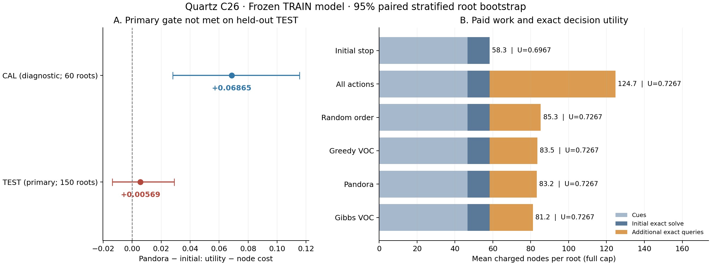

# Quartz C26 연구 결과와 다음 단계

2026-11-23. 이전 C25 commit: d6019d674ae76524b1895016f49b82d4f7b001b2. 브랜치: research/quartz-general-c26-game-metareasoning-20261123.

## 결론

이론 연구 R01–R10과 코딩 연구 C01–C10을 수행했다. 원 논문의 KL/Gibbs 선택과 계산가치(VOC)를 실제 GameState 질의에 연결했고, 독립 exact-reveal 모형의 STOP·예약값 정리, 계산으로 얻는 정보에 한정한 fluctuation 보정, 상세균형 Markov/Lindblad 구성을 유도·검산했다. 신규 Rust controller와 Python oracle/campaign을 구현하고 TRAIN90 → CAL60 → TEST150의 동결된 실험을 실행했다.

사전 지정한 TEST의 양의 노드 비용 차감 이득 기준은 통과하지 못했다.

\[
\widehat{\Delta J}_N=\overline{\Delta U-2^{-10}\Delta N}
=0.005690104166666667,\qquad
95\%\mathrm{CI}=[-0.013693033854166667,\;0.029039388020833317].
\]

정확한 결정 효용은 개선됐지만 그 개선에 비해 확인 비용이 컸다. CAL의 양의 결과로 TEST를 대체하지 않았고, TEST를 본 뒤 모델·가격·정책을 수정하지 않았다. 이는 구현 실패와 구분되는 primary empirical admission 미통과다. 전역 불가능성 주장도 아니다.

근거는 [THEORY.md](THEORY.md), [CODING.md](CODING.md), [C08 결과](coding/C08_RESULTS.md), [독립 심사](review/INDEPENDENT_REVIEW.md), [실제 복원](evidence/C09_RESTORE.json)에 있다. 다음 C27은 [제안 문서](NEXT_C27_PROPOSAL.md)에 계획만 남겼다.

## 1. 원래 어떤 이론을 도입하려 했는가

최초 도달 가능한 commit 15f3a1986a00d548d3da56dab8233b336e931aee, legacy 도입 commit 3bcaa435b6bdca2f821f8990230ea05ddf251a2f, 원 PDF·ZIP 내부 문서·실제 COG01 소스를 읽었다. 문서 내부의 1월 날짜와 4월/7월 Git 도입 날짜를 구별했다. 원 PDF SHA256은 74d8848012f1ad95fbf2320a8f0392654c800c641d3d37ea90b81dead154547b다. 정확한 위치와 byte identity는 [원 이론 지도](ORIGIN_THEORY_MAP.md), [provenance](ORIGIN_PROVENANCE.json)에 있다.

| 원 모티프 | 원 자료의 실제 내용 | C26 도입 수준 | 남아 있는 연결 |
|---|---|---|---|
| 통계역학 변분 자유에너지·Gibbs | 원 PDF p5 Eq1, 기대효용−KL | 변분 항등식과 실제 seeded Gibbs metacomputation sampling | 물리적 온도·뇌·MCTS 전체 동역학과의 동일성 |
| 인지과학 rational metareasoning·VOC | pp5–6 FOCUS/EXPAND/MERGE/STOP, 결정 개선−비용 | TRAIN 인식·유료 exact verification·incumbent 유지·순이득 STOP | 큰 게임 resident MCTS와 인간 행동 서명 |
| fluctuation·cumulant·one-loop | log partition, Gaussian/Laplace, 고차 cumulant | posterior mean covariance의 2차 보정·remainder·exact 반례 | 기존 log1p·역방문수 휴리스틱의 제1원리 유도 |
| detailed balance·open quantum system | 초기 archive의 Lindblad/Gibbs 주장 | 수정 generator·offdiagonal jump·유한 CPTP channel 기호/수치 구현 | 실제 검색 dynamics의 물리적 실현 |
| hidden modes·nested sampling·기하 | 미탐색 질량·hidden-max proxy·TT holonomy/curvature | 원 출처·기존 reservoir/reopening 재확인, 공동신념 후속 문제 | evidence quadrature와 실제 TT 기하 제어 |
| Friston 자유에너지 원리 | action-prior KL surprise, Friston2010 인용 | action discrepancy와 생성모형 ELBO/active inference의 구별 | 인지 생성모형·검증 가능한 인간 예측 |
| RG·Wick 회전·criticality | 초기 업로드에 실제 가설 존재 | path normalizer·diagonal-jump 오류를 특정하고 보존 | coarse graining·유효작용·임계성 유도 |

Information bottleneck/rate distortion는 조사한 원 문헌 범위에서 명명된 정식화를 찾지 못했다. 이후 새 연결로 제안할 수 있으나 원래부터 있었다고 귀속하지 않았다. 대화 검색에만 등장하고 저장소에서 확인되지 않은 chunk/template/replay 서술도 원 소스로 승격하지 않았다.

원 동기는 일반적인 불확실성 기반 계산 배분과 같은 실제 자원 아래 더 나은 게임 결정을 함께 요구한다. C23–C25의 SPD 기제 연구를 유지하면서 C26은 실제 GameState로 돌아왔다. 아직 Gomoku Elo, NN 평가량 P2, 인간-GM P3를 입증한 것은 아니다.

## 2. 직접 유도한 결정 문제

### 정의·단위

root player의 exact minimax 값 \(v_a\in\{-1,0,1\}\)에서 \(U_a=(v_a+1)/2\in\{0,1/2,1\}\)를 정의한다. \(b\)는 terminal 관측 또는 exact 질의로 확인된 최선 효용이다. 후보 전체를 유지하고 \(b'=\max(b,U_a)\)로 갱신하며 tie에는 incumbent를 유지한다.

첫 선택은 네 번의 무작위 플레이 cue 평균에 따르며 필요한 exact 검증은 유료다. cue·초기 검증·추가 질의의 노드를 모두 기록한다. exact solver는 cache/pruning 없이 진입한 상태를 센다. root와 terminal player의 부호 변환을 독립 Python oracle로 검증했다.

이 효용은 승률 추정치가 아니라 유한 root 집합의 exact minimax utility다. \(\lambda_N=2^{-10}\)는 효용/노드, \(\tau=2^{-5}\)는 효용 단위다. \(\tau\)를 Kelvin 온도로 해석하지 않는다.

### STOP과 질의 순서

독립적인 미관측 값, 고정 가산 비용 \(d_a>0\), 완전한 reveal, 관측 후 다시 선택 가능한 후보와 알려진 fallback을 가정한다.

\[
g_a(b)=\mathbb E[(U_a-b)_+],\qquad
V(b,S)=b\iff g_a(b)\le d_a\quad(\forall a\in S).
\]

순차 질의에서 \(b_t\ge b\)이고 \(g_a\)는 \(b\)에 대해 감소한다. 독립성으로 다음 질의의 조건부 기대 순증분은 \(g_a(b_t)-d_a\)다. 처음 모든 항이 비양수라면 어떤 유한 적응적 질의열도 양의 기대 순증분을 만들지 못한다. 양의 항 하나가 있으면 그 한 번의 검사가 STOP보다 낫다. 등호에서 STOP의 유일성을 주장하지 않는다.

최적 순서는 단순한 \(g_a-d_a\) 순위와 다르다. 예약값을

\[
\mathbb E[(U_a-z_a)_+]=d_a
\]

로 정의하고 가장 큰 \(z_a>b\)인 후보를 여는 것이 독립 full-horizon 모형의 Pandora 규칙이다. Weitzman의 기존 결과를 알려진 incumbent와 3점 효용으로 연결했다. 직접 capped-variable 증명과 정확한 유리수 Bellman 대조를 제공했으며 새 보편 정리라고 주장하지 않는다.

\(p_0,p_{1/2},p_1\), \(\mu=p_{1/2}/2+p_1\)에서 계산식은 다음 순서의 분기다.

\[
z=
\begin{cases}
1-d/p_1,&p_1>0,\ d\le p_1/2,\\
(\mu-d)/(p_{1/2}+p_1),&p_{1/2}+p_1>0,\ d\le\mu,\\
\mu-d,&\text{otherwise}.
\end{cases}
\]

support 경계·퇴화 경우를 검산했다. binding query cap, 상관된 값, 실제 비용과 예측 비용의 차이는 원 정리의 가정을 바꾼다. 모형 최적성을 실제 게임의 최적성으로 바꾸지 않았다.

### Gibbs를 실제 표본화

STOP 점수 0, 질의 점수 \(Q_a=g_a-d_a\), 고정 양의 reference prior \(\pi\)에 대해

\[
J_\tau(q)=q\cdot Q-\tau D_{\rm KL}(q\Vert\pi),\qquad
q^\star_a=\frac{\pi_a e^{Q_a/\tau}}{\sum_b\pi_b e^{Q_b/\tau}}.
\]

정확한 항등식

\[
\tau\log Z-J_\tau(q)=\tau D_{\rm KL}(q\Vert q^\star)
\]

이 최적성을 증명한다. 새 Rust 코드는 이 확률에서 실제 표본을 뽑는다. 유한 \(\tau\)에서는 음의 \(Q\)도 선택될 수 있고, 국소 KL 목적의 최적성이 raw net 또는 다단계 Bellman 최적성을 뜻하지 않는다. 정확한 승리 \(b=1\)에는 명시적 STOP certificate가 있다.

## 3. 통계물리 연결의 실질적 교정

### 총 불확실성과 얻을 정보

\[
F_\tau(\mu)=\tau\log\sum_a\pi_a e^{\mu_a/\tau},\qquad
H_F=\frac{\operatorname{diag}(q)-qq^\top}{\tau}.
\]

계산 \(Y\) 후 평균 \(\mu^Y=\mathbb E[U\mid Y]\)에 대해 calibrated 모형에서 \(\mathbb E\mu^Y=\mu\)다. 그 계산의 smoothed 정보가치는

\[
G_\tau(Y)=\mathbb E F_\tau(\mu^Y)-F_\tau(\mu)\ge0.
\]

2차항은

\[
\frac{1}{2\tau}\left[\sum_aq_aC_{aa}-q^\top Cq\right],
\quad C=\operatorname{Cov}(\mathbb E[U\mid Y]).
\]

\(C\)를 총 latent covariance로 바꾸면 일반적으로 틀린다.

\[
\operatorname{Cov}(U)=\mathbb E\operatorname{Cov}(U\mid Y)
+\operatorname{Cov}(\mathbb E[U\mid Y]).
\]

또한 \(H_F\mathbf1=0\)이라 대안을 구별하지 않는 공동 이동은 이 quadratic decision term에 들어가지 않는다. 유한 signal 모형의 정확값·2차값·remainder를 계산했다. 정보 없는 채널의 실제 값은 0인데 총 latent covariance를 잘못 넣으면 1.20071947이 나온다. 강한 signal 예에서는 exact smoothed gain0.178002와 2차값0.300180의 차이를 보존했다. 이는 검증된 수학 모듈이며 게임 controller의 성능 개선을 입증한 결과는 아니다.

### 상세균형과 Lindblad

원 archive의 대각 \(L_a\propto|a\rangle\langle a|\) jump만으로는 population이 변하지 않는다. 따라서 그것으로 Gibbs population relaxation을 유도할 수 없다.

\(a\ne b\)에 대해 열 \(b\)에서 행 \(a\)로 가는 rate를

\[
W_{ab}=\frac{\kappa}{m-1}\min(1,q_a^\star/q_b^\star),\qquad
W_{bb}=-\sum_{a\ne b}W_{ab}
\]

로 구성했다. 그러면 \(W_{ab}q_b^\star=W_{ba}q_a^\star\), \(Wq^\star=0\)이다. \(\kappa\)는 알고리즘 완화시간의 역수다. \(P=I+\delta W\)는 \(0\le\delta\le1/\kappa\)에서 stochastic·비음수이며 \(0<\delta<1/\kappa\)에서 strict positivity/KL contraction 조건을 만족한다. \(\delta=0\)은 항등변환이다.

\(L_{ab}=\sqrt{W_{ab}}|a\rangle\langle b|\)는 population transfer를 만들며 별도 유한 Kraus 구성이 trace-preserving임을 확인했다. 이 channel을 무조건적인 Lindblad Euler map 또는 \(\exp(\delta\mathcal L)\)와 같다고 하지 않는다. \(H=0\)이라 \(\hbar=1\) 가정도 도입하지 않았다.

세 상태 rational matrix·detailed balance·KL 수축·임의 밀도행렬·Kraus 완전성·fluctuation covariance에 대해 72개 검증을 실행했다. Wolfram의 독립 계산에서도 보존·정상성 residual0을 얻었다. 수학적 stochastic construction의 성립과 물리적 MCTS 등가성은 구별한다.

## 4. 실제 구현·동결 실험

코드는 [Rust controller](../../../src/bin/quartz_c26_game_metareasoning.rs), [Python campaign](coding/c26_campaign.py), [독립 테스트](../../../tests/test_c26_game_metareasoning.py)다. 기존 GameState/TicTacToe를 사용하며 핵심 게임·MCTS 소스는 보존했다. [CODE_CONTRACT](coding/CODE_CONTRACT.md)와 [SOURCE_SPECS](coding/SOURCE_SPECS.json)는 결과 전에 고정했다.

300개 canonical reachable root를 TRAIN90/CAL60/TEST150으로 나눴다. 모델은 TRAIN의296개 nonterminal candidate로만 적합했다. add-one smoothing의 3점 categorical model, 남은 칸 수별 TRAIN 평균 exact node 비용을 쓴다. model SHA256은 0843447dc755c1d09e1bc69a44dd052e6db9c5c2ace41d1590b668cbfc36a126이다.

정책6개, cap1/2/9, policy seed4개, timing9회와 별도 trace를 동결했다. root가 통계 단위다. CI는 ply 층화 root bootstrap2,000회이며 고정 TRAIN fit에 조건부다. seed·반복을 독립 표본으로 부풀리지 않았고 root가 descendant를 공유할 수 있다는 한계를 기록했다.

| Full-cap TEST 정책 | 평균 exact utility | 전체 노드 | 추가 노드 | native 시간 µs | 노드 차감 효용 |
|---|---:|---:|---:|---:|---:|
| INITIAL_STOP | 0.696667 | 58.3133 | 0 | 2.724110 | 0.639720 |
| ALL_ACTIONS | 0.726667 | 124.7200 | 66.4067 | 4.889702 | 0.604870 |
| RANDOM_ORDER | 0.726667 | 85.2600 | 26.9467 | 3.643057 | 0.643405 |
| GREEDY_VOC | 0.726667 | 83.4733 | 25.1600 | 3.601163 | 0.645150 |
| PANDORA | 0.726667 | 83.2067 | 24.8933 | 3.587080 | 0.645410 |
| GIBBS_VOC | 0.726667 | 81.1567 | 22.8433 | 3.581522 | 0.647412 |

공통 cue46.6133노드와 초기 검증11.7노드가 포함된다. native timing은 cue·solver·controller를 포함하며 request transport/model loading은 별도다. 시간은 해당 장비·선언된 native 경계의 측정이다.

각 source/seed cell에서 모든 nonbaseline 정책이 ALL_ACTIONS와 같은 full-cap exact utility를 얻었다. 보편 성질은 정확히 알려진 최선을 보존해 초기 선택보다 나빠지지 않는다는 것이며, 언제나 전역 최적 utility나 양의 net gain이라는 것은 아니다.

Pandora는 utility0.03을 얻고 추가 노드 비용0.0243099를 지불했다. gross gain의81.03%다. ALL_ACTIONS보다41.5133노드,1.30262µs를 줄였지만 그 비교군은 알려진 승리 뒤에도 전수 질의한다. RANDOM_ORDER도 승리 certificate로 크게 줄인다. 전체 절감을 학습 prior나 Gibbs 고유 기여로 귀속할 수 없다.

Pandora의 RANDOM_ORDER 대비 절감2.05333노드, Gibbs의 Pandora 대비 절감2.05노드는 다중비교 보정 없는 secondary 결과다. Gibbs−Pandora wall-time CI는0을 포함한다. Gibbs의 전반적 우월성이나 원 P2 달성을 주장하지 않는다.

### 사후 진단

TEST150개 중 처음부터 최적인 root142개, 개선 가능8개였다. Pandora는 이미 최적인 root52개에 추가 질의했고, 추가 노드3,734개 중3,208개, **85.91%**를 그 집단에 썼다. 개선 가능 집단에는526노드를 써 summed utility4.5를 얻었다.

CAL은60개 중9개가 개선 가능했고 평균 headroom0.0833333이었다. TEST는0.03이었다. CAL primary diagnostic +0.0686523 [0.0279773,0.115512]을 TEST 대신 채택하지 않았다.

TEST Pandora 선택 질의692개(600source/seed cells)에서 예측 one-step gain 합82.0845, 실제 증가 합18.0이었다. 예측 비용13,770.8257노드, 실제14,936노드였다. 이득 예측의 선택 조건부 불일치가 후속 문제다. 상관 누락의 인과 증명은 아니다.

TEST pooled Brier0.327273, equal-parent Brier0.306133, 후보 비용 actual/predicted mean22.7495/21.6289, MAE4.69127, RMSE7.68832다. within-root residual correlation0.176731은 descriptive 수치다. 독립성 증명이나 새 TEST fit으로 사용하지 않았다.

## 5. 검증과 실패 분류

| 항목 | 실제 근거 | 판정 |
|---|---|---|
| 수학 oracle | 유리수9,495사례, Bellman/index·STOP 일치 | numerically checked, 직접 증명도 존재 |
| 통계물리 기제 | 72assertions, Wolfram exact residual0 | derived + numerically checked |
| native | 신규18tests, release build | implementation-verified |
| Python focused | 21tests; reviewer 별도20read-only tests | implementation-verified |
| 전 게임 oracle | 4,520nonterminal roots,16,167children | 값·부호·노드·cue 비용 일치 |
| 전체 Rust | exit0,754successful invocations,89ignored,12targets | 실행 수; 독립 과학 검증 수가 아님 |
| 원자료 독립 감사 | timed136,080 + trace15,120runs, TRAIN 전체 재적합 | frozen identity·계산·추론 일치 |
| 전체 Python | 기존 test의 torch 부재, collection exit2 | runtime/dependency blocker |
| GitHub CI | C08 cargo/real-loop success; 기존 Ruff format 실패 | 전체 CI green 아님 |
| TEST primary | CI가0을 포함 | positive-net admission 미통과 |
| C07 게시 | ignore로 CAL 원자료 누락 | provenance defect, C08 교정 |

현재 scoped Ruff check는 exit0(34files)이나 전체 포맷 부채는 C25부터 존재한다. [C08 Actions](https://github.com/cosmosapjw-quantum/quartz/actions/runs/45152189354)와 evidence/C10_CI_CONTEXT_C08.json에 실제 기록을 보존했다. 최종 commit의 CI는 게시 뒤 별도 receipt와 최종 전달에서 확인한다.

## 6. Drift watchdog·백업·게시

원 P1–P4 목표를 유지했다. THESIS에는 원문과 충돌하던 두 범위를 좁혀 교정했다. Runtime estimated VOI/VOC는 허용하지만 offline oracle/signature labels는 runtime에 주지 않는다. KL/Gibbs·fluctuation처럼 유도·검증된 기제는 허용하지만 근거 없는 literal physics와 성능 우위는 주장하지 않는다. 변경 전후 SHA/문장은 evidence/POLICY_CORRECTIONS.json에 있다. CLAIM_LEDGER의 기존 주장 수준은 올리지 않았다.

각 이론10·코딩10단계를 별도 commit·누적 archive·remote 확인으로 게시했다. C07의 CAL 원자료 누락은 소급하여 정상으로 기록하지 않았다. C08에서 두 결과 묶음16files를 추적하고 CAL 보충 archive를 만들었다. Reviewer가 모든 commit blob과 원자료 byte identity를 확인했다. 이후 publisher는 누락된 result file을 거절한다.

C09에서 C23 full base + C24/C25/C26 C08 overlay를 실제 복원했다. 2,768Git files,1,106,732,654bytes, executable modes와 정확한 file set을 검증했다. 이전14worktrees의 HEAD/status/보호 파일을 보존했고 release binary도 별도 압축·해제 hash 검증을 했다.

Dropbox에서 C08까지18stage archives,3base archives,보충본·binary·model의 이름·크기를 확인했다. 이는 cloud metadata acknowledgement다. Cloud bytes를 별도로 다운로드한 SHA 검증과 같지 않다. Local synced archives의 SHA/실제복원과 remote Git identity는 각각 수행한 범위대로 기록했다.

C10 자신의 hash를 자기 문서에 미리 포함할 수 없으므로, 최종20stage chain/archive/remote/clean-tree 검증은 coding/final_delivery_audit.py가 백업 폴더의 FINAL_AUDIT_<head>.json에 기록한다. 최종 cloud metadata도 별도 외부 receipt다. 이전19stage receipts는 evidence/STAGE_RECEIPTS_THROUGH_C09.jsonl에 있다.

## 7. 다음 단계

질문은 **incumbent와 다른 후보의 exact reveal로 미질의 후보들의 공동 posterior를 갱신하면 불필요한 확인 비용과 selected-gain 오차가 줄어드는가**다. C26 product prior는 다른 후보 reveal에 반응하지 않는다.

작은 joint distribution, 실제 Bayes update, depth2 Bellman을 먼저 도입하고 독립곱 대조군과 초기 주변분포를 같게 맞추는 것이 다음 최소 실험이다. 선택 정책의 Gibbs와 효용 벡터의 joint Gibbs law는 다른 대상이다. 자세한 수학 계약, 경계 사례, 새 평가집합과 stop condition은 [C27 제안](NEXT_C27_PROPOSAL.md)에 있다.

C26 TEST는 결과를 본 기존 평가 자료로 고정한다. 새 seed나 symmetry copy도 새 root가 아니다. 가용 신규 root와 descendant 관계를 먼저 확인하고, 같은 크기·층화의 새 집합이 남았다고 가정하지 않는다. 실제 controller 비용까지 포함한다. C27의 계산·적합·campaign은 현재 실행하지 않았다. 다음 연구 턴은 [CONTINUATION.md](CONTINUATION.md)에서 시작한다.

## 외부 원전

- Weitzman, Optimal Search for the Best Alternative: [저자 보관 논문](https://scholar.harvard.edu/files/weitzman/files/optimalsearchbestalternative.pdf), [1978원본](https://www.osti.gov/servlets/purl/6795538). 독립 full-reveal·비용·recall 조건의 예약값 탐색.
- Ortega & Braun, Thermodynamics as a theory of decision-making with information-processing costs: [저자 원문](https://adaptiveagents.org/_media/papers/thermodynamicsdecision.pdf). prior-weighted Gibbs 변분 형식.
- Lieder & Griffiths, Resource-rational analysis (2020): [원문](https://perception.jhu.edu/files/PDFs/20_ResourceRationality/LiederGriffiths_ResourceRationality_BBS.pdf). 계산 비용과 성과의 절충.
- Hay et al., Selecting Computations (2012): [UAI원문](https://www.auai.org/uai2012/papers/123.pdf). metalevel computation selection.
- Friston, The free-energy principle: a unified brain theory? (2010): [저자 원문](https://www.fil.ion.ucl.ac.uk/~karl/NRN.pdf). 원 QUARTZ의 역사적 인용과 비교하며 본 기제의 인지적 타당성 증명으로 대신하지 않는다.

문헌의 정리, 직접 유도, 유한 수치 검증, 구현 검증과 실증 성능 가설은 각 절에서 구분했다.
