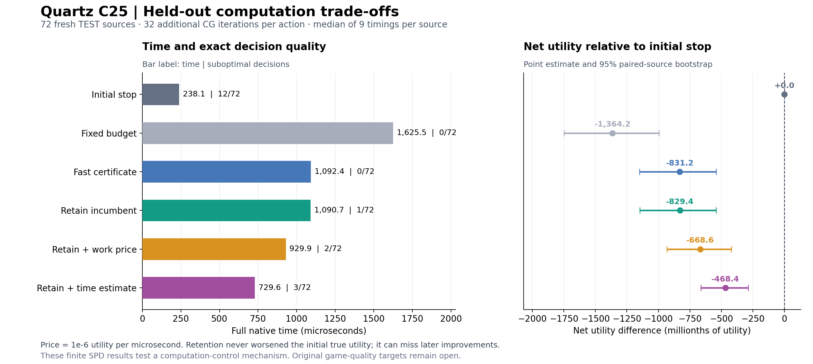

# Quartz C25 — 초기 선택을 보존하는 계산 제어와 가격 기반 중단

작성일: 2026-11-23, Asia/Seoul. 기준 C24 commit: `4998c771c08788e4f0da8d2723347121ae16fbf2`.
검증한 C25 실험 snapshot: `d45173685f955820bd848bf4ddb2044382ca7e67` (C08).
최종 게시 identity는 [STAGE_PUBLICATIONS.json](STAGE_PUBLICATIONS.json)과 외부 최종 게시 영수증에서 확인한다.

## 1. 연구 결론

C25는 C24에서 관찰한 “추가 계산 뒤 선택한 행동의 실제 효용이 더 나빠질 수 있음”을 직접 다뤘다. 유효한 효용 구간을 교집합으로 축적하고, 현재 선택보다 엄격히 낫다고 증명된 후보로만 교체하는 제어기를 실제 구현했다. 이 규칙은 초기 `PLAIN_STOP` 선택의 참 효용을 보존한다. 새로운 TEST 72개, 추가 예산 3개, retention 정책 3개의 서로 다른 648개 결과에서 초기 효용 감소는 0이었다.

계산 가격을 반영하는 충분조건도 유도하고 구현했다. 모든 허용된 후속 계산이 실제로 지불해야 하는 비용 하한이 있으면, 가능한 최대 효용 이득의 상한과 그 하한을 비교하여 유료 계산을 중단할 수 있다. 이번 구현의 엄밀한 비용 단위는 명시적으로 정의한 cell-stencil charge다. TRAIN 시간 예측기를 사용하는 별도 정책은 같은 효용 보존 규칙을 따르지만, 시간 가격 판단은 경험적이다.

주 경제성 가설은 지지되지 않았다. 사전에 고정한 가격 \(10^{-6}\) utility/μs에서 `RETAIN_TIME − PLAIN_STOP`의 평균 순효용은 \(-4.683900086636479\times10^{-4}\), paired-source bootstrap 95% 구간은 \([-6.629366545796896,-2.8780714297975434]\times10^{-4}\)였다. 이 음수 결과를 유지했다. `PLAIN_ALWAYS` 대비 55.11%의 시간 절감은 관찰했으나, 해당 비교에서 최적 선택 3개를 놓쳤다. 초기 선택 보존과 고정 예산 최종 선택에 대한 비열등성은 서로 다른 주장이다.

이번 연구는 원래 Quartz의 STOP/FOCUS 계산 제어를 유한 SPD 문제에서 검증한 결과다. 원래 게임 실력, Gomoku P2, 신경망 평가 절감, P3 구조 가설, production MCTS 적용은 이 결과로 종결되지 않는다. C26은 실행하지 않았다.

근거: [이론 유도](theory/DERIVATION.md), [주 TEST 요약](evidence/C25_TEST_SUMMARY.json), [정확 검증](evidence/C25_VERIFY_TEST_TRACE.json), [독립 검토](review/C09_REVIEW.md), [주장 상태](CLAIMS.json).

## 2. 원 동기와 drift watchdog

[ORIGIN_WATCHDOG.md](ORIGIN_WATCHDOG.md)와 [ORIGIN_PROVENANCE.json](ORIGIN_PROVENANCE.json)은 저장소의 실제 root와 이전 문서의 byte identity를 연결한다.

| 원전 | 확인한 내용 | 날짜와 해석 |
|---|---|---|
| Git root `15f3a1986a00d548d3da56dab8233b336e931aee`의 README | Rust MCTS/AlphaZero, P_flip 중단, prior refresh, 상태에서 유도한 제어, 게임별 성능 평가 | 실제 Git 날짜 2026-04-09, +09:00 |
| `docs/legacy/QUARTZ_docs.zip`의 `QUARTZ/PRD.md` | CPU-only, game-agnostic, 동일 평균 예산에서 더 나은 Elo, 초기 +50 Elo 목표와 공정한 비교 | 문서 내부 날짜 2026-01-28. 이를 1월 Git 기록으로 주장하지 않음 |
| `docs/legacy/QUARTZ_paper.pdf` | FOCUS/EXPAND/MERGE/STOP, 실제 시간 비용 추정, 기대 개선과 비용의 비교 | 문서 내부 날짜 2026-01-29, Git import는 2026-07-12 |
| THESIS 고정 commit `7241ad0cfe1e92f28bd8cded5ad5f9fe7d4b4eab` | P1 계산당 기대 regret 감소, P2 Gomoku 7×7 비열등 실력과 ≥30% nn_evals_per_move 절감 | 목표의 정의이며 달성 증거가 아님 |

원래 동기는 두 축이었다. 첫째는 계산을 어디에 얼마나 배분할지 결정하는 일반 원리다. 둘째는 공정한 CPU/시간 조건에서 실제 게임 결정을 개선하는 것이다. 일반화 가능성이 처음부터 있었고, 실제 게임 품질도 처음부터 목표였다. 따라서 “일반 계산 제어는 나중에 새로 생긴 목표”와 “게임 실력은 애초 연구 목표가 아니었다”는 두 해석 모두 원전과 맞지 않는다.

C17–C22의 일부 설명이 게임 품질 목표를 과도하게 배제했던 점을 C25에서 명시적으로 교정했다. 과거 원본은 고치지 않았다. 현재 결과의 범위를 STOP/FOCUS에 한정하고, 게임으로의 연결 과제를 다음 단계에 보존했다. EXPAND의 미표현 후보, MERGE의 값/증거 보존, 비정상적 MCTS backup의 확률 보정은 별도 문제다.

이후 매 연구 턴에는 이전 anchor의 hash를 재사용하면서 현재 parent와 변경된 연구 주장을 대조한다. 매번 오래된 전체 연구를 다시 실행하는 절차가 아니라, 원래 목적·현재 객체·증거·남은 연결을 확인하고 실제 다음 유도/실험에 반영하는 절차다. 자세한 지속 규칙은 [ORIGIN_WATCHDOG_RESULT.json](ORIGIN_WATCHDOG_RESULT.json)에 있다.

## 3. 수학적 객체와 컨벤션

이번 객체는 연속장 이론이 아닌 유한한 무차원 SPD 의사결정 문제다. 공간 경계는 zero-exterior five-point stencil이고,

\[
A=I+\rho L_D,\qquad n=\mathrm{side}^2,\qquad
1\le\lambda_{\min}(A)\le\lambda_{\max}(A)\le1+8\rho.
\]

각 행동 \(a\)의 참 효용은 고정되어 있다.

\[
u_a=\frac{b_a^\mathsf{T}A^{-1}b_a}{S}\in[0,1].
\]

\(S\)는 모든 행동에 공통인 보수적 power-of-two 정규화다. 계산은 참 효용을 바꾸지 않고 그에 대한 수치 상태와 정보만 바꾼다. C25는 C24의 허용 입력 범위, 정확한 산술 검증, outward rounding을 유지했다. native domain은 side 2–128, 정수 \(\rho\) 0–64, 행동 수 2–8 및 기존 RHS/상태 제한이다. 실제 fresh cohort는 side 8/32/96과 \(\rho=1/16/64\)를 사용했다.

임의의 반복 상태 \(x_a\), 잔차 \(r_a=b_a-Ax_a\)에서

\[
b_a^\mathsf{T}A^{-1}b_a
=2b_a^\mathsf{T}x_a-x_a^\mathsf{T}Ax_a
+r_a^\mathsf{T}A^{-1}r_a.
\]

따라서 \(\alpha=1,\ \beta=1+8\rho\)를 사용하면 정확 산술에서

\[
\frac{\ell_a+\|r_a\|^2/\beta}{S}
\le u_a\le
\frac{\ell_a+\|r_a\|^2/\alpha}{S},
\qquad
\ell_a=2b_a^\mathsf{T}x_a-x_a^\mathsf{T}Ax_a.
\]

실제 native endpoint는 이 식을 그대로 nearest rounding한 값이 아니다. C24의 검증된 오차 포락과 방향 반올림으로 만든 enclosure를 그대로 재사용한다. 새 제어기는 그 위에서 동작한다.

### 3.1 초기 선택을 보존하는 교체 규칙

fresh 구간을 누적 교집합으로 갱신한다.

\[
L_a(t)=\max_{s\le t}L_a^{\rm fresh}(s),\qquad
U_a(t)=\min_{s\le t}U_a^{\rm fresh}(s).
\]

초기 incumbent \(i_0\)는 `PLAIN_STOP`와 동일한 초기 CG 4회, ordinary score, tie break로 정한다. 현재 lower endpoint의 최댓값을 갖는 후보 \(j\)를 고르고

\[
L_j>U_i
\]

일 때만 \(i\leftarrow j\)로 바꾼다. 그러면

\[
u_j-u_i\ge L_j-U_i>0,
\qquad
u_{\rm final}\ge u_{i_0}.
\]

교체하지 않을 때는 동일 행동을 유지하므로 이 부등식은 전체 실행과 예산 소진 시 반환까지 이어진다. 모든 lower endpoint의 최댓값을 골랐기 때문에 한 번의 scan과 최대 한 번의 교체로 그 checkpoint에서 가능한 엄격한 교체를 모두 처리한다.

이 규칙은 큰 lower endpoint 자체를 최종 목표로 삼지 않는다. max-L 후보는 일반적으로 minimax-regret 행동이 아니며, 겹치는 구간 때문에 실제 개선을 놓칠 수 있다. \(\,L_j=U_i\,\)는 엄격 개선이 아니므로 교체하지 않는다. weak optimality, unique optimum, 가격 기반 중단도 별도 flag다.

### 3.2 가능한 효용 개선의 상한

현재 incumbent의 simple regret와 계산 가능한 상한은

\[
r_i(u)=\max_a u_a-u_i,\qquad
G_i=\max\!\left(0,\max_{j\ne i}U_j-L_i\right)
\]

이다. 항상 \(0\le r_i\le G_i\)다. 직사각형 구간 집합에서는

\[
\sup_{v\in\prod_a[L_a,U_a]}(\max_a v_a-v_i)=G_i.
\]

한 competitor를 upper endpoint, incumbent를 lower endpoint에 두면 양의 상한을 달성한다. SPD 구조처럼 행동 간 제약을 추가한 더 작은 feasible set에서는 상한이 보수적일 수 있다.

구간 교집합만 수행할 때 \(G_i\)는 증가하지 않는다. 엄격 교체 \(i\to j\)에서도

\[
G_j\le G_i-(L_j-L_i)\le G_i.
\]

즉 효용 보존과 regret 상한의 비증가를 동시에 얻는다. 이는 posterior 평균 개선량의 추정이 아니다.

### 3.3 유료 후속 계산에 대한 충분조건

현재 무료로 가능한 인증 교체를 먼저 처리했다고 하자. 모든 허용된 양의 후속 계산 정책 \(\pi\)가 같은 완전한 행동 집합에서 최종 행동 \(A_\pi\)를 반환하고, 실제 미래 증분 비용이 모든 경로에서

\[
C_\pi\ge c_{\min}\ge0
\]

을 만족하며 가격이 \(\lambda\ge0\)이면,

\[
(u_{A_\pi}-u_i)-\lambda C_\pi
\le G_i-\lambda C_\pi
\le G_i-\lambda c_{\min}.
\]

따라서

\[
\boxed{G_i\le\lambda c_{\min}}
\]

이면 지금 incumbent를 반환하는 선택이 모든 허용된 유료 후속 계산보다 순효용 면에서 나쁘지 않다. 적응적·무작위·여러 단계의 후속 계산에도 같은 상한이 적용된다.

이 명제는 충분조건이다. \(G_i>\lambda c_{\min}\)이라고 해서 유익한 계산이 존재한다는 결론은 나오지 않는다. 또한 이미 지불한 초기 계산비는 이 국소 비교에서 상쇄되지만, 정책 전체를 `PLAIN_STOP`와 비교할 때는 포함해야 한다. 지금 잘 멈췄다는 증명으로 앞서 지불한 비용을 회수할 수는 없다.

임의의 무료 비인증 재선택, 아직 표현되지 않은 출력 후보, 범위가 바뀌는 효용에는 추가 조건이 필요하다. 이번 구현은 고정된 완전 행동 집합과 정의된 계산 class에 대한 정리다.

## 4. 계산 비용과 실제 구현

새 native binary는 [quartz_c25_incumbent_price.rs](../../../src/bin/quartz_c25_incumbent_price.rs)다. C24의 numerical prefix와 원본 파일은 보존했고, 새로운 controller를 추가했다.

| 정책 | 실제 동작 |
|---|---|
| PLAIN_STOP | 초기 ordinary 선택을 반환 |
| PLAIN_ALWAYS | 지정된 추가 CG 예산 뒤 ordinary 선택 |
| FAST_BLOCK | 기존 C24 certificate 중단 및 기존 fallback |
| RETAIN_BLOCK | 인증된 엄격 교체만 수락, 예산 종료 시 incumbent 반환 |
| RETAIN_WORK | retention + 증명된 charge 하한에 대한 가격 중단 |
| RETAIN_TIME | retention + TRAIN 시간 예측에 대한 경험적 가격 중단 |

추가 계산 block은 CG 8회 단위이며, 각 양의 block 이후에는 CG가 실제로 0회만 전진했더라도 모든 \(K\) 행동의 fresh FAST readout을 수행한다. 이 계약으로

\[
W=n(N_{\rm solver\ matvecs}+N_{\rm FAST\ action\ evals}
+N_{\rm ordinary\ action\ evals}),\qquad
c_{\min}=Kn
\]

을 얻는다. \(W\)는 cell-stencil charge이며 total flop이나 wall time이 아니다. 선택한 work 가격은 정확한 dyadic 수 \(2^{-30}\) utility/charge다.

native에서는 \(G\)를 위로, 가격 threshold를 아래로 반올림한다. 모든 competitor upper endpoint가 incumbent lower endpoint 이하이면 gap을 정확히 0으로 처리한다. 인증된 work-price stop은 이 보수적 비교를 통과해야 한다.

시간 규칙은 다른 근거를 갖는다. TRAIN의 active RETAIN_BLOCK 실행에서 continuation_us/executed_blocks를 반복 평균한 다음, side별 parent 중앙값을 고정했다.

| side | 고정한 예측 block 시간 | active TRAIN parents |
|---:|---:|---:|
| 8 | 8.914666666666667 μs | 7 |
| 32 | 116.66068055555556 μs | 10 |
| 96 | 1004.2051666666666 μs | 10 |

이 예측값은 oracle 효용, CAL, TEST를 사용하지 않았다. 예측이 실제 block 비용의 보편적 하한이라는 증명은 없으므로 TIME stop은 가격 인증으로 표시하지 않는다.

native 전체 시간은 validation, 초기 계산, readout, controller, continuation, 상태 정리를 포함한다. JSON 직렬화와 offline oracle 분석은 제외한다. 모든 정책을 같은 C25 환경에서 다시 측정했다. source별 timing 9회의 중앙값을 만든 뒤 source 간 동일 가중 평균을 사용했다.

## 5. 사전 고정과 fresh TEST

144개 fresh source는 36 TRAIN, 36 CAL, 72 TEST로 구분했다. side 3개 × rho 3개 × gap 유형 4개의 36개 층을 유지하고 C24와 다른 ID/seed를 사용했다. exact dyadic manufactured solution으로 public RHS와 숨겨진 정확 효용을 별도로 만들었다. oracle은 native input에 들어가지 않는다.

추가 예산은 8/32/128, 주 예산은 32다. 주 정책은 RETAIN_TIME, 주 비교는 PLAIN_STOP, 주 가격은 \(10^{-6}\) utility/μs다. 각 source-budget에 trace 1회와 timing 9회, warmup 1회를 사용했다. 분석의 독립 단위는 source이며 timing 반복이 아니다.

TRAIN predictor는 C07A commit `3cdc8e4a043be4d2b1c707dceba6954d388930bc`에서 보존했다. C07의 [freeze](evidence/C07_PRE_TEST_FREEZE.json)는 코드, 계약, 분석기, 검증기, predictor, binary 등 16개 과학 입력을 TEST 생성 전에 hash로 고정했다. 주 조건은 이보다 앞선 R09에서 고정되어 있었다. TEST 뒤 정책, 가격, 모델, 분석법을 수정하지 않았다.

### 주 결과: 추가 예산 32

잘못된 선택은 exact oracle 최대 효용보다 엄격히 낮은 행동을 고른 경우다. 동률 최적 행동은 오류가 아니다. 시간은 source별 9회 중앙값의 72-source 평균이다.

| 정책 | 전체 시간 (μs) | 최적 선택 실패 / 72 | 평균 simple regret | 초기보다 효용 감소 |
|---|---:|---:|---:|---:|
| PLAIN_STOP | 238.081 | 12 | \(2.3173332\times10^{-5}\) | 0 |
| PLAIN_ALWAYS | 1,625.492 | 0 | 0 | 0 |
| FAST_BLOCK | 1,092.421 | 0 | 0 | 0 |
| RETAIN_BLOCK | 1,090.677 | 1 | \(1.2942908\times10^{-9}\) | 0 |
| RETAIN_WORK | 929.865 | 2 | \(7.4396994\times10^{-9}\) | 0 |
| RETAIN_TIME | 729.633 | 3 | \(1.1326950\times10^{-8}\) | 0 |

RETAIN_TIME은 초기의 잘못된 선택 12개 중 9개를 개선하고 3개를 남겼다. PLAIN_ALWAYS 대비 시간은 55.1131%, solver matvec는 64.2574% 줄었지만, 같은 선택 품질을 유지한 비교는 아니다. 주 예산에서 FAST_BLOCK은 PLAIN_ALWAYS와 exact utility가 같았으며, 이는 retention 정책과 별도로 남겨둔 유효한 control 결과다.

### 주 경제성 판정

\[
J=u-\lambda t,\qquad \lambda=10^{-6}\ {\rm utility}/\mu{\rm s}.
\]

주 비교 RETAIN_TIME − PLAIN_STOP은

\[
\begin{aligned}
\overline{\Delta u}&=2.3162005225240992\times10^{-5},\\
\overline{\Delta t}&=491.5520138888889\ \mu{\rm s},\\
\overline{\Delta J}&=-0.0004683900086636479.
\end{aligned}
\]

source를 짝지어 2,000회 재표집한 percentile bootstrap 95% 구간은

\[
[-0.0006629366545796896,\;-0.00028780714297975434]
\]

이다. 고정한 효용 정규화와 가격 아래에서 추가 효용 이득이 추가 비용을 상쇄하지 못했다.

보조 비교 RETAIN_TIME − PLAIN_ALWAYS는 \(+0.000895847173049579\), 95% 구간 \([0.0006332512903306129,\ 0.0011888049912116847]\)였다. 이는 고정 예산까지 계산하는 정책보다 효율적인 중단이 가능했다는 관찰이다. 주 비교가 음수라는 사실을 대체하지 않는다.

추가 가격 0, \(10^{-8}\), \(10^{-7}\), \(10^{-5}\)의 분석은 같은 정책 결정을 재평가한 민감도 분석이다. 각 가격에서 정책을 다시 최적화하거나 TEST로 가격을 고른 실험이 아니다.

이 구간은 고정한 synthetic source 집합에 대한 source 재표집 요약이다. 임의의 게임, hardware, 가격, 실제 배포 분포에 대한 보편적 보장으로 읽을 수 없다. 가격의 효용 단위는 정규화 \(S\)에 의존하므로 다른 문제로 옮길 때 가격도 명시적으로 변환해야 한다.

### 예산에 따른 보수성

| 정책 | 추가 8: 오류 수 | 추가 32: 오류 수 | 추가 128: 오류 수 |
|---|---:|---:|---:|
| PLAIN_STOP | 12 | 12 | 12 |
| PLAIN_ALWAYS | 5 | 0 | 0 |
| FAST_BLOCK | 5 | 0 | 0 |
| RETAIN_BLOCK | 7 | 1 | 0 |
| RETAIN_WORK | 7 | 2 | 2 |
| RETAIN_TIME | 7 | 3 | 3 |

추가 8에서 PLAIN_ALWAYS와 FAST_BLOCK은 초기 선택보다 실제 효용이 감소한 fresh source가 각각 2개였다. retention 정책의 감소는 0개였다. 그러면서도 retention은 구간이 겹친 실제 개선을 놓쳤다. 이 두 사실을 함께 보존해야 효용 보존의 비용을 제대로 평가할 수 있다.

주 예산에서 TRAIN 시간 모델과 heldout active-parent block 시간 중앙값은 side 8/32/96에서 각각 8.915/8.900, 116.661/112.571, 1004.205/987.343 μs였다. 이 기술 통계는 보편적 비용 하한을 주지 않는다. 또한 주 경제성 실패를 단순한 큰 시간 예측 오류라고 단정할 근거도 없다. \(G\)가 최대 가능한 개선의 상한이라는 사실은 실제로 달성 가능한 개선이나 기대 개선을 예측하지 못한다.

## 6. 검증과 실패 분류

수학적 유도, 수치 포함성, 구현, 실행환경, 경제성 결론을 구분했다.

| 층 | 실행한 검증 | 결과와 적용 범위 |
|---|---|---|
| 이론 | exact Fraction 구간 3,375개, incumbent 10,125개, box corner 81,000개; 교체 2,541개와 charged 비교 87,192개 | 유도와 일치. 일반 정리의 증명은 위 수학이며 유한 검산이 이를 대체하지 않음 |
| 방향 산술 | binary64 비교 20,000개 | 선택한 보수적 gap/threshold 방향 확인 |
| symbolic 예 | exact SPD 예 3개 | 실제 개선, ordinary 재선택의 손실, retention의 개선 누락을 각각 구성. 임의 수학적 iterate이며 CG trace라는 주장은 하지 않음 |
| Rust | debug 40/40, release 40/40; binary별 invalid/valid input stream | 실제 종료 코드 0. 27개 C24 재사용, 12개 변화 대상 RED→GREEN, 1개 추가 불변량 |
| Python | 18개 테스트 | 실제 통과. 이 중 12개 변화 대상 RED→GREEN |
| UNIT | fresh 4개 + 이전 adverse fixture 1개 | 과거 ordinary/FAST 손실 재현, retention 방지. 주 fresh 추정에서 제외 |
| TEST exact | trace interval 28,584개, timing interval 104,976개 | 정확 oracle 포함성 확인 |
| TEST 제어 | gap checkpoint 1,529개, readout floor 881개, 엄격 교체 76개, WORK 가격 중단 41개 | 선언된 제어와 비용 계약 확인 |
| retained 결과 | 72 sources × 3 budgets × 3 policies = 648개 | 초기 효용 감소 0 |
| timing 대응 | TRAIN/CAL/TEST timing outcome 23,328개 | 각각의 trace와 과학적 signature 일치 |
| 독립 C09 | production analyzer/verifier를 import하지 않은 원시 재구성 | 18개 TEST 정책–예산 조합의 평균/주 가격 bootstrap, TRAIN predictor, exact utility와 제어 증거 재계산 |

독립 검토는 scientific code나 frozen input을 수정하지 않았고 새 native campaign을 실행하지 않았다. [C09_REVIEW_CHECKS.json](review/C09_REVIEW_CHECKS.json)은 실제 명령, 환경, 입력 hash, 741,888개 Ax=b 성분 검증과 216개 exact utility 비교를 포함한다.

Wolfram의 첫 직접 계산은 교체·가격 부등식과 예를 확인했다. 별도 context 요청과 뒤의 확장 요청에서 내부 오류 -32603이 발생했으며 그 호출은 성공으로 세지 않았다. exact Python/SymPy 검산이 별도로 존재한다.

R01 게시 helper의 경로 오류로 첫 backup/receipt가 C24 backup 위치에 추가되었던 사건은 [repair evidence](evidence/R01_PUBLICATION_REPAIR.json)에 보존했다. C25 경로를 수정하고 R01 사본을 hash 검증했으며 C24 receipt는 이전 byte identity로 복구했다. 초기 테스트 scaffold 오류와 의도한 RED 결과도 분리해 남겼다. 이런 실행/기록 오류는 보존된 음수 경제성 결과와 다른 종류의 실패다. C09의 첫 게시 precheck는 Matplotlib SVG의 줄 끝 공백 때문에 commit 전에 중단됐다. 원본 SVG를 압축 보존한 뒤 공백만 정리하고 1,389개 XML element의 순서·text·attribute token 동일성을 확인하여 같은 precheck를 통과했다. PNG와 과학 입력은 바꾸지 않았다.

## 7. 문헌에서 재사용한 것과 C25의 기여

유료 계산의 가치와 perfect-information ceiling은 기존 메타추론 문헌에 있다. Hay et al.의 Theorem 4–5 및 §6.1은 비용을 포함한 계산 가치와 VOI 상한을 다룬다. LUCB의 §3.1은 유효한 confidence bound를 통한 식별 중단을 다룬다. 이 확률적 보장을 C25의 deterministic enclosure와 동일시하지 않았다.

이번 기여는 일반적인 새 no-go 정리가 아니다. 기존 원리의 조건을 분리하고, C24에서 실제 나타난 선택 악화를 막는 controller를 정확 수치 envelope 위에 구현하고, 계산 가격을 고정한 fresh 실험에서 그 장점과 실패를 함께 확인한 것이다. 전체 MCTS에 대해 불가능성을 주장하거나, elementary dominance lemma를 새로운 보편 이론으로 주장하지 않는다.

원전과 정확 위치:

1. Hay, Russell, Tolpin, Shimony (2012), [Selecting Computations: Theory and Applications](https://www.auai.org/uai2012/papers/123.pdf), Definition 3, Theorems 4–7, §6.1 Eq. (11).
2. Kalyanakrishnan, Tewari, Auer, Stone (2012), [PAC Subset Selection in Stochastic Multi-armed Bandits](https://www.cs.utexas.edu/~pstone/Papers/bib2html-links/ICML12-shivaram.pdf), §3.1, Theorem 1, Eq. (4).
3. Kaufmann, Cappé, Garivier (2016), [On the Complexity of Best-Arm Identification in Multi-Armed Bandit Models](https://www.jmlr.org/papers/volume17/kaufman16a/kaufman16a.pdf), §1, p.2.
4. Bubeck, Munos, Stoltz (2011), [Pure Exploration in Finitely-Armed and Continuous-Armed Bandits](https://chercheurs.lille.inria.fr/munos/papers/files/TCS2011.pdf), §2 simple regret.

상세 식별과 적용 조건은 [LITERATURE.md](theory/LITERATURE.md)에 있다.

## 8. 백업, 게시, 재현

모든 R01–R10, 이어서 C01–C10을 수행하고 단계별 commit/누적 archive/push/remote HEAD 확인을 사용한다. TRAIN predictor의 C07A freeze를 별도 checkpoint로 추가했다. 최종 archive는 C24 parent 이후 C25 변경 파일 전체를 담으며, 이전 archive를 순서대로 적용하여 복원한다.

C09에서는 C23 base + C24 overlay + C25 C08 overlay를 새 임시 경로에 실제 복원했다. 추적 파일 2,603개, 1,097,124,692 bytes가 C08 Git blob과 일치했다. release binary도 별도 압축 사본을 만들고 압축 해제 hash를 확인했다. 이전 13개 worktree의 각자 HEAD/status/protected file은 보존되었다.

최종 C10 게시 검증은 전체 단계 receipt chain, 모든 archive SHA-256, 최종 archive 내부 파일, artifact manifest, frozen 입력, remote HEAD, clean worktree를 검사한다. 자기 commit을 포함한 최종 영수증은 Git 밖에 둔다. Dropbox 경로의 로컬 backup 및 복원은 검증했지만 Dropbox 서버의 동기화 acknowledgement는 확인하지 않았다.

[REPRODUCE.md](REPRODUCE.md)는 기존 원시 자료로 독립 재분석하는 명령과 새 실행을 분리한다. 원본 증거는 덮어쓰지 않는다.

## 9. 다음 단계: 실제 GameState로 연결하는 C26

C26은 다음 한 사이클의 제안이며 이번 실행에 포함하지 않았다. 목적은 C25의 결정 불변량을 기존 게임 인터페이스의 root action으로 옮기고, 기대 개선을 최악 상한과 혼동하지 않은 상태에서 원래 CPU/게임 목표와의 연결을 강화하는 것이다.

기존 `src/game.rs`의 `outcome()`은 terminal current-player 관점이다. root player \(p_r\), terminal state player \(p_s\)가 ±1일 때

\[
v_{\rm root}(s)=p_rp_s\,\mathrm{outcome}(s),\qquad
u_{\rm root}=\frac{v_{\rm root}+1}{2}.
\]

이 부호와 가격 단위 변환부터 고정한다. complete legal actions와 미탐색 child의 \([-1,1]\) bound를 유지하면 max/min interval backup으로 root 행동 enclosure를 구성할 수 있다. 실제 게임의 continuation은 경로와 state identity를 함께 보존해야 한다.

이미 있는 TicTacToe `GameState`를 사용해 초기 상태에서 legal move로 도달 가능한 국면만 만든다. exact minimax oracle은 평가에만 쓰고 runtime에는 넣지 않는다. board를 임의 생성한 뒤 무조건 합법이라고 간주하지 않는다. 완전 후보 coverage, root 관점 부호, 동률, terminal, transposition identity, budget exhaustion을 검사한 뒤 node 확장/backup/controller 비용을 실제로 센다.

`src/mcts/policy/finite_metalevel.rs`에 이미 finite Bayesian reference가 있다. 같은 reference를 새 연구처럼 다시 만드는 대신 필요한 비교에 재사용한다. 해당 모듈은 production SearchPolicy 구현이나 신경 MCTS 보정의 증거가 아니므로 그 경계를 유지한다.

C26의 성공 조건은 기존 GameState에서 유효한 root bound, 참 효용 보존, 실제 cost–quality trade-off, 정확 oracle과의 차이를 재현하는 것이다. 게임 맞춤 전략을 주입하지 않는다. 그 뒤에야 neural/MCTS interval calibration과 Gomoku P2 평가로 넘어갈 수 있다. 주 경제성이 다시 음수여도 결과를 보존하고, TEST에 맞춰 조건을 바꾸지 않는다.

실행할 이론 10단계와 후속 코딩 10단계, 단계별 백업/게시 및 매 턴 watchdog 규칙은 [NEXT_STAGE.json](NEXT_STAGE.json)에 구체화했다.
