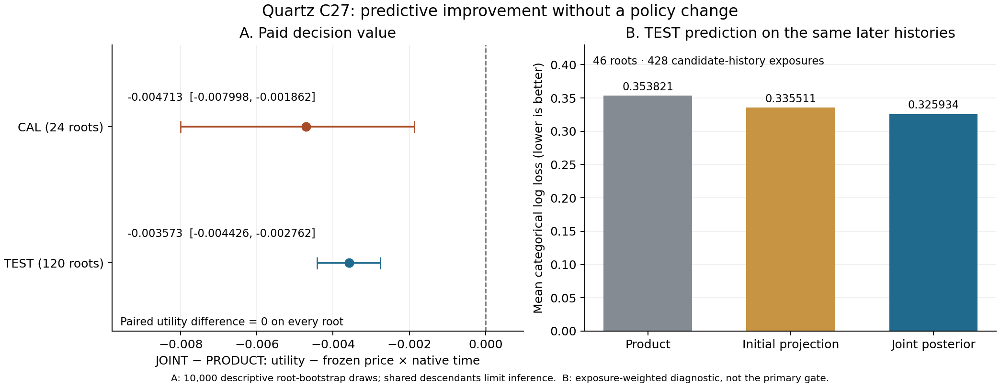

# C08 — frozen TEST campaign and interpretation

**The empirical paid-decision admission gate failed.** The finite posterior/H2 implementation and trace validation passed; this is a negative operational result, not a mathematical contradiction or an environment failure.

## Execution and primary result

TEST120 roots have frozen ply4/5/6 counts6/45/69. Four policy seeds, five measured repeats and five policies give480 native requests and12000 validated policy runs, plus one unmeasured warmup per policy/seed. Campaign, independent verification and analysis each exited0. All source/model/binary/price hashes matched the C06 bundle. No CAL-driven changes were made.

The fixed primary contrast is JOINT_H2 minus PRODUCT_H2. Utility is dimensionless (loss0, draw1/2, win1); elapsed time is ns. Net wall utility is U-lambda_time_ns*elapsed_ns, with lambda_time_ns=2.0515750995723287e-05 fixed from TRAIN.

|Metric|Mean paired root difference|95% descriptive paired-root interval|
|---|---:|---|
|additional_nodes|0|[0, 0]|
|additional_queries|0|[0, 0]|
|charged_nodes|0|[0, 0]|
|elapsed_ns|174.160416667|[134.64953125, 215.73796875]|
|net_nodes|0|[0, 0]|
|net_wall|-0.00357303174164|[-0.0044260264472, -0.00276243625482]|
|regret|0|[0, 0]|
|utility|0|[0, 0]|

The net lower bound is negative. The quality lower bound0 meets the predeclared -0.02 constraint, but this cannot rescue the failed net gate. All120 paired root quality/node/query differences are exactly zero. Net-root signs are94 negative and26 positive, reflecting measured timing differences.

Root summaries use median5 measured times, then mean4 seeds. The10000 bootstrap resamples use PCG64 seed2709 and the actual120-root mixture, without equal-ply reweighting. Shared descendants violate independent-tree interpretation; these intervals are descriptive for this fixed campaign.

## Policy-level means

|Policy|Utility|Native elapsed ns|Net wall utility|Additional queries|
|---|---:|---:|---:|---:|
|INITIAL_STOP|0.691666667|2663.245833|0.637028178|0.000000000|
|RANDOM_TWO|0.720833333|3124.508333|0.656731698|0.750000000|
|PRODUCT_H2|0.720833333|3154.016667|0.656126313|0.758333333|
|INITIAL_PROJECTED_H2|0.720833333|3394.179167|0.651199199|0.758333333|
|JOINT_H2|0.720833333|3328.177083|0.652553281|0.758333333|

JOINT minus INITIAL_PROJECTED has a secondary timing-driven net difference+0.001354082307 [0.000614477730,0.002062218714], with zero utility difference. This comparison does not establish a decision-quality benefit from later conditioning, and does not replace the predeclared PRODUCT primary contrast. RANDOM_TWO timing includes instrumented H2 diagnostics and is not an optimized bare-random benchmark.

## Prediction changed without changing decisions

Independent raw-data review found identical JOINT, PRODUCT and INITIAL_PROJECTED trajectories for all96 CAL and480 TEST root-seed pairs, including initial solve/incumbent, full query order, final move and outcome/node sequence. TEST posterior probabilities changed by up to0.15 and Q values by0.191436: the posterior mechanism executed, but the evaluated histories did not cross a decision boundary. Detailed independent recalculation evidence is finalized in C09.

In TEST,74 roots issue zero additional queries because the initial exact-known incumbent already has utility1. One root starts at0 and reveals utility1 on its first additional query. Forty-five roots use both additional queries. Of these45,17 have no unobserved candidate left and27 have a nonwinning incumbent with unknown candidates remaining; one has final utility1. This is a bounded late-game allocation regime, not evidence that correlated beliefs can never matter.

On JOINT-generated histories, all predictors are evaluated on the same remaining candidates:

|Stage|Predictor|Roots|Candidate-history exposures|Log loss|Brier|Selected direct-gain MAE|
|---|---|---:|---:|---:|---:|---:|
|initial|initial_projected|120|1116|0.453820772|0.230627284|0.140248582|
|initial|joint|120|1116|0.453820772|0.230627284|0.140248582|
|initial|product|120|1116|0.456999167|0.230145574|0.146948029|
|later|initial_projected|46|428|0.335511390|0.174191616|0.082242257|
|later|joint|46|428|0.325934310|0.168918083|0.075473855|
|later|product|46|428|0.353821202|0.181682245|0.094854785|

Later TEST diagnostics improve for the joint model relative to the product model, but initial Brier loss is slightly worse. CAL later losses also moved in the opposite direction. Therefore no uniform calibration improvement is claimed. These exposure-weighted prediction diagnostics are not the root-weighted primary outcome and cannot rescue its gate.

The complete candidate-vector log-likelihood improvement is+0.03456076973169756 per TEST root, versus-0.050757164630264265 on CAL and+0.08255961204382367 in TRAIN cross-validation. A predictive likelihood gain does not by itself imply a changed action or paid utility improvement.

## Scope and next research question

The constructive R05 information-only example and exact53851 assertions remain valid: a finite correlated belief can change profitable computation. This particular restricted common-factor family, frozen small-game cohort, known-only incumbent and two-query cap did not deliver paid improvement. It does not justify a strong no-go for joint metareasoning, arbitrary dependence, larger games or the original cognitive/statistical-physics programme.

C28 should first establish action-sensitive, non-saturated allocation regimes using development data and a genuinely new evaluation domain, then choose whether a richer joint family is necessary. The original same-ply frame is now exhausted as fresh campaign roots. C28 is proposed only; no new fit or experiment has been started.

