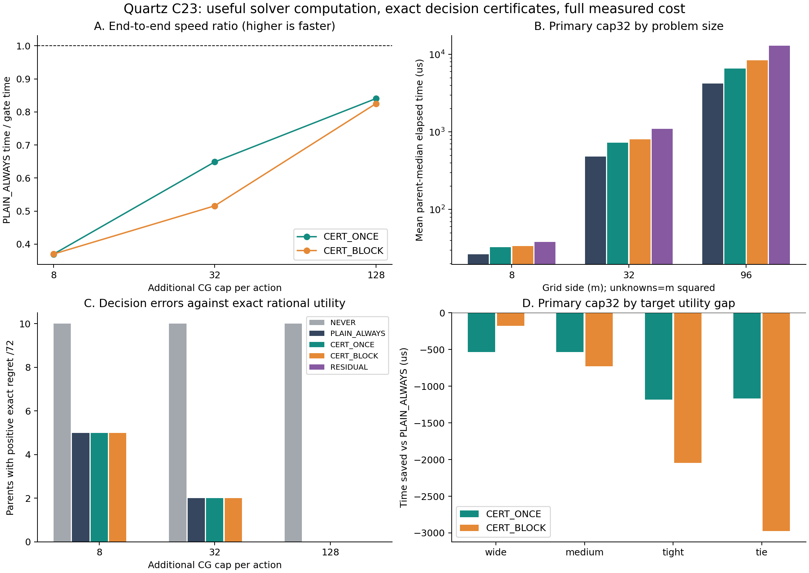

# Quartz C23 — 잔차 인증에 의한 계산 중단: 결과와 다음 연구

작성 기준일: **2026-11-23, Asia/Seoul**

연구 ID: **QUARTZ-GENERAL-23-CHEAP-GATE-AND-MATCHED-WORKLOAD-ECONOMICS**

부모 C22: `6e91e3abfbc6727d58c0785ffdf80a7e3e7cabaf`

브랜치: `research/quartz-general-c23-residual-stop-20261123`

## 1. 판정

C23은 C22의 “작은 작업에서는 계산 중단 판단 비용이 절약한 작업보다 크다”는 결과를 이어받아, 실제 희소 선형계 풀이를 중단하는 구성적 방법을 만들고 측정했다. 이론 R01–R10 뒤에 구현·검증·실험 C01–C10을 수행했다. 데이터 생성 직후의 게시 지점 C07A와 C08A도 별도로 두었다.

**수학적 결과:** 유효한 잔차 기반 효용 구간이 엄격히 분리되면, 남은 선형계 계산을 수행하지 않고도 정확한 최적 행동을 선택할 수 있다. 인증되지 않으면 기존 고정 예산 풀이와 동일한 상태·선택으로 돌아가는 구현을 구성했다. 이 조건에서 gated policy의 참 효용은 고정 예산 비교군보다 나쁘지 않다. 기반 이차형식 오차 항등식과 스펙트럼 경계는 고전적이며, 전역적인 이론적 신규성을 주장하지 않는다.

**실험 결과:** 주 예산에서 반복 검사형 CERT_BLOCK은 CG matvec 호출을 7,321회에서 4,085회로 줄였으나, 총 벽시계 시간은 효율적인 PLAIN_ALWAYS보다 길었다. 평균은 1.580 ms에서 3.061 ms로 증가했다. 현재 구현에서 “유용한 계산을 실제로 생략했다”는 주장은 성립하지만, “총 계산 비용을 개선했다”는 주장은 채택하지 않는다.

**남은 결함:** 일반 허용 f64 입력 전체에 대해서는 매우 작은 RHS의 norm 제곱 underflow로 잔차 목표 달성을 잘못 보고하는 반례가 있다. 동결된 제조 입력 범위 밖의 결함이며, 해당 반례에서 잘못된 의사결정 인증은 발생하지 않았다. 결과를 얻은 바이너리는 그대로 보존하고 다음 사이클의 수치 안정성 수정 대상으로 남겼다.

C24는 다음 연구 제안으로 기록했으며 **실행하지 않았다**. 원래 THESIS의 Gomoku P2, P3, P4를 입증한 결과로 해석하지 않는다.

## 2. 문제, 단위와 정의

한 변의 격자 크기를 \(m\), 자유도 수를 \(n=m^2\)라 한다. 외부값을 0으로 두는 Dirichlet 5점 연산자 \(L_D\)는 대각 4, 존재하는 인접점에 \(-1\)을 갖는다. 실험에서는

\[
A=I+\rho L_D,\qquad \rho\in\{1,16,64\}
\]

를 사용한다. 내부 edge 차이 제곱과 경계 edge 항으로 이차형식을 쓰면 양의 정부호임을 확인할 수 있다. 보수적인 고유값 경계는

\[
\alpha=1,\qquad\beta=1+8\rho,\qquad \alpha I\preceq A\preceq\beta I.
\]

각 행동 \(a\in\{1,2,3\}\)에 RHS \(b_a\)가 주어지고, 선택할 참 효용은

\[
q_a=b_a^\mathsf T A^{-1}b_a,\qquad u_a=q_a/S
\]

이다. 공통 척도 \(S\)는 정확히 표현되는 2의 거듭제곱이며 \(S\ge\max_a\|b_a\|^2\)이다. 따라서 \(0\le u_a\le1\). 컨트롤러의 공개 입력은 \(A\)의 격자 매개변수, \(S\), \(b_a\)이고, 제조 정답 \(x_a^\ast\)나 \(q_a\)를 직접 제공하지 않는다.

이 연구의 대상은 **무차원 유한 이산 문제**다. 격자 크기를 바꾼 것은 작업량을 바꾼 것이며, 고정된 물리 PDE의 연속체 극한을 검증한 것은 아니다. 벽시계 시간의 단위는 \(\mu s\), 비용 계수 \(\lambda\)의 단위는 효용/\(\mu s\)다. CPU cycle이나 실제 물리량으로 환산하지 않았다.

## 3. 직접 유도한 인증과 그 범위

임의의 현재 iterate \(x\)에 대해

\[
\ell=2b^\mathsf T x-x^\mathsf T A x,\qquad r=b-Ax
\]

를 정의한다. \(x^\ast=A^{-1}b\), \(e=x^\ast-x\)로 놓으면

\[
\begin{aligned}
q-\ell
&=(x^\ast)^\mathsf T A x^\ast-2(x^\ast)^\mathsf T A x+x^\mathsf T A x\\
&=e^\mathsf T A e
=r^\mathsf T A^{-1}r .
\end{aligned}
\]

그러므로

\[
\ell+\frac{\|r\|^2}{\beta}
\le q\le
\ell+\frac{\|r\|^2}{\alpha}.
\]

이 항등식은 \(x\)가 정확한 CG 직교성을 만족할 필요가 없다. 실제 저장된 iterate에서 **새로 계산한 참 잔차**를 사용하며, 재귀 잔차를 인증 잔차로 대체하지 않는다. 고전적 배경과 유한 정밀도 주의점은 [1,2]를 참조한다.

\(S\)로 나누고 이미 증명된 \([0,1]\) 범위와 교집합을 취해 효용 구간 \([L_a,U_a]\)를 만든다. 과거의 유효 구간들과도 교집합을 취한다. 어떤 \(i\)에 대해

\[
L_i>\max_{j\ne i}U_j
\]

가 성립하면 모든 경쟁 행동에 대해 \(u_i>u_j\)이므로 \(i\)는 유일한 정확 최적 행동이다. 이때 미래 계산이 참 효용을 더 잘 추정하더라도 최적 행동은 바뀌지 않는다. 이 유효 구간들에 지지되는 임의의 확률법칙 아래에서도 추가 정보의 gross decision value는 0이다. 이것은 uncertainty-set에 대한 결과이며, 구간을 Bayesian posterior로 해석하거나 MCTS EVSI를 추정한 결과가 아니다.

일반 행동 \(i\)의 후회에는

\[
\operatorname{regret}(i)
\le\max\left(0,\max_{j\ne i}U_j-L_i\right)
\]

라는 상한도 얻는다. 미래 계산의 확실한 비용 하한과 비교하는 확장은 가능하지만, 측정 시간의 중앙값을 확실한 비용 하한으로 취급하지 않았다.

구현의 고정 예산 비교 정리는 두 경우로 나뉜다.

1. 인증되어 중단하면 정확 최적 행동을 반환하므로 ALWAYS의 어떠한 반환 행동보다 참 효용이 낮지 않다.
2. 인증되지 않으면 동일한 CG 업데이트를 수행하고 동일한 최종 \(\ell\) argmax와 tie rule을 적용하므로 ALWAYS와 상태·선택이 같다.

따라서 조건부로 \(u_{\rm gate}\ge u_{\rm ALWAYS}\)이다. 이것은 **모든 제한 예산 결과가 정확 최적이라는 정리도, 모든 미래 근사 argmax가 현재 선택과 같다는 정리도 아니다.** 주 예산 TEST에 실제 비인증 오선택이 2건 있다.

### 정확 산술 사례

\(m=2,\rho=1\)에서 \(A\)의 대각은 5, 인접 비대각은 \(-1\)이다. 두 RHS와 초기 iterate를

\[
b_1=(1,0,0,0),\quad b_2=(0,\tfrac12,\tfrac12,0),\quad x_a=b_a/5
\]

로 정하면 다음을 얻는다.

| 양 | 행동 1 | 행동 2 |
|---|---:|---:|
| 정확 \(q\) | \(23/105\) | \(5/42\) |
| \(\ell\) | \(1/5\) | \(1/10\) |
| \(\|r\|^2\) | \(2/25\) | \(2/25\) |
| 비정규화 구간 | \([47/225,\,7/25]\) | \([49/450,\,9/50]\) |

\(47/225>9/50\)이므로 첫 행동을 인증한다. Wolfram 실제 평가와 별도 Python Fraction 선형대수 계산이 동일한 결과를 냈다. 행렬식은 525, 고유값은 \(7,5,5,3\)이다. 증거는 [R07_EXACT.json](evidence/R07_EXACT.json)과 [독립 Fraction 계산](theory/check_r07_fraction.py)에 있다.

## 4. 부동소수점 구현과 정확한 source identity

[새 Rust 실행 파일](../../../src/bin/quartz_c23_residual_gate.rs)은 기존 엔진과 분리되어 있다. 구간의 각 기본 연산에서 next_down/next_up을 사용해 바깥 방향 반올림을 적용한다. 저장된 f64 입력과 iterate를 정확한 실수로 간주하고, interval stencil로 \(Ax\), 참 잔차, 제곱합, \(\ell\)과 응답 구간을 계산한다. 비유한 값이나 공집합을 오차 tolerance 확대 방식으로 숨기지 않는다. 조건은 명시된 IEEE binary64 연산과 fast-math 재결합을 사용하지 않는 컴파일 계약이다.

제조 입력은 \(x^\ast=z/2^{30}\) 꼴의 정수 벡터로 만들고, 정수 stencil로 먼저 \(b\)의 분자를 계산한다. f64 변환 전에 분자 크기를 \(2^{53}\) 아래로 제한하므로 공개 \(b\)는 의도한 dyadic 값과 정확히 같다. 정답은 별도 정수/Fraction 경로로 계산한다. 독립 검증기는 production generator를 import하지 않고 edge-energy 표현과 실제 공개 RHS를 대조한다.

개발 중 숫자형 JSON 입력이 네이티브 serde_json 경로에서 일부 RHS를 1 ULP 바꾸는 결함을 실제로 발견했다. 과학적 transport는 Python shortest-decimal 문자열과 Rust FromStr 조합으로 수정했고, 네이티브가 받은 실제 f64 bit를 출력해 전량 비교했다. 숫자형 호환 입력 자체의 bit identity는 주장하지 않는다. 실패와 수정 증거를 모두 남겼다.

- Rust source SHA256: `8a5aad2d9c8b0a9fd8df0efd5310604f7b498d16447df0f222aa9619a15ad8ed`
- 측정 release binary SHA256: `812c57e75ad193fa4cca3729fc63ee59df73cac7118c50886adb4c0b47118ac0`
- TEST 실행 당시 source HEAD: `c918fbad6255a7e3a1f0a3be3f1e70cbd409326c`

바이너리, 소스, 공개 입력, 정답, 실행 출력의 identity는 서로 다른 객체로 보존했다. 이후 문서·게시 commit의 SHA가 바뀌어도 측정 바이너리의 출처는 위 binding으로 추적한다.

## 5. 동결된 실험 설계

총 144 parents를 \(m\in\{8,32,96\}\), \(\rho\in\{1,16,64\}\), 목표 gap wide/medium/tight/tie의 36개 stratum에 배치했다. 각 stratum에 TRAIN 1, CAL 1, TEST 2를 두어 36/36/72로 나누었다. 목표 gap은 각각 0.25, 0.03, \(10^{-5}\), 0이며, 실제 품질 평가는 제조 목표 label 대신 정확 Fraction oracle로 수행한다.

모든 고정 예산 정책은 행동별 초기 CG 4회 후 최대 추가 8, **32(주 예산)**, 128회를 사용한다. 수치적 exhaustion은 공통 규칙을 따른다. CERT_BLOCK은 추가 8회마다 검사한다. TEST 결과로 정책·checkpoint·가격·예산을 조정하지 않았다.

| 정책 | 실제 동작 |
|---|---|
| measured NEVER | 초기 CG와 초기 구간 평가 후 현재 선택을 반환 |
| ALWAYS | 고정 추가 CG를 수행하고 마지막 구간·점수 평가 |
| PLAIN_ALWAYS | 동일 CG·동일 최종 \(\ell\) 선택, 비싼 outward 구간 없이 일반 응답 평가 |
| CERT_ONCE | 초기 1회 인증되면 중단, 아니면 ALWAYS와 동일한 나머지 계산 |
| CERT_BLOCK | 초기 및 8회 간격 검사; 인증되지 않으면 동일한 고정 예산 fallback |
| RESIDUAL | 상대 재귀 잔차 \(10^{-8}\), cap 512; fresh residual 진단을 함께 기록 |

PLAIN_ALWAYS는 첫 코호트 결과를 보기 전에 추가한 비교군이며, [프로토콜 수정 기록](coding/C05_PROTOCOL_AMENDMENT.md)에 시점을 남겼다. 이 비교군 없이 비싼 ALWAYS만 기준으로 삼으면 효율성을 과장할 수 있다. RESIDUAL의 full-field 정확도 계약은 행동 선택 정책의 계약과 다르다. measured NEVER에는 초기 구간 비용이 있으므로 무료 STOP이나 최적화된 최소비용 STOP으로 해석하지 않는다.

각 parent·budget·policy에 warmup 1회와 측정 9회를 실제 실행했다. 정책 순서를 순환시키고 parent별 중앙값을 먼저 구한 뒤 72 parents 평균을 냈다. 2,000회 paired parent bootstrap, seed 2300923을 사용했다. 반복 실행 9개를 독립 연구 표본으로 세지 않았다. bootstrap 구간은 **균형 있게 제조된 혼합 코호트의 기술적 요약**이며 실사용 분포의 신뢰구간으로 일반화하지 않는다.

타이머는 네이티브 검증, allocation, 초기 풀이, 모든 구간/일반 평가, continuation, workspace destruction을 포함한다. JSON decode/serialize, source 제조, oracle과 사후 분석은 제외한다. 하드웨어는 AMD Ryzen 9 5900X, Rust 1.99.0이며 단일 스레드로 실행했다. 모든 비교군을 물리적으로 실행했으므로 전체 연구 캠페인이 그만큼 자원을 덜 썼다고 주장하지 않는다.

## 6. TEST 결과

### 주 예산: 초기 4 + 추가 최대 32회/행동

아래 시간은 72 parents의 각 9회 측정 중앙값을 평균한 벽시계 시간이다.

| 정책 | 시간 \(\mu s\) | 오선택 / 72 | 정확 최적 인증 | ALWAYS보다 이른 종료 | CG 호출 절감 |
|---|---:|---:|---:|---:|---:|
| measured NEVER | 835.32 | 10 | 0 | 72 | 6,457 |
| PLAIN_ALWAYS | 1,579.51 | 2 | 0 | 0 | 0 |
| ALWAYS | 2,752.76 | 2 | 0 | 0 | 0 |
| CERT_ONCE | 2,434.33 | 2 | 17 | 17 | 1,450 |
| CERT_BLOCK | 3,061.35 | 2 | 52 | 49 | 3,236 |
| RESIDUAL | 4,680.61 | 0 | 0 | 40 | −4,572 |

CERT_BLOCK의 52건 인증 중 49건만 실제로 비교군보다 일찍 끝났다. 예산 끝에서 인증된 경우를 조기 종료로 세지 않았다. CG 호출 절감 3,236/7,321은 **44.2%**이지만 격자별 호출 비용이 다르므로 FLOP 또는 CPU 비용 44.2% 절감으로 바꾸어 말하지 않는다.

PLAIN_ALWAYS, ALWAYS, 두 gated policy의 평균 정확 후회는 \(2.360685521032404\times10^{-9}\)이다. 작은 양이지만 0은 아니다. 두 비인증 오선택을 숨기지 않는다. 인증된 선택은 모두 정확 oracle의 최적이었다.

시간 절감의 부호를 \(t_{\rm baseline}-t_{\rm gate}\)로 두면 다음과 같다.

| gated policy | 비교군 | 평균 절감 \(\mu s\) | paired descriptive 95% 구간 |
|---|---|---:|---:|
| CERT_ONCE | PLAIN_ALWAYS | −854.82 | [−1,204.99, −513.25] |
| CERT_BLOCK | PLAIN_ALWAYS | −1,481.84 | [−2,163.24, −844.21] |
| CERT_ONCE | ALWAYS | +318.43 | [+92.13, +607.57] |
| CERT_BLOCK | ALWAYS | −308.59 | [−844.17, +205.78] |

CERT_ONCE가 구간을 계산하는 ALWAYS보다 빨랐다는 사실만으로 효율적인 고정 풀이를 개선했다고 말할 수 없다. 주 비교군 PLAIN_ALWAYS에 대해서는 두 gate 모두 더 느렸다.

응답 평가의 평균 비용은 PLAIN_ALWAYS 41.57 \(\mu s\), ALWAYS 1,212.12 \(\mu s\), CERT_ONCE 1,113.94 \(\mu s\), CERT_BLOCK 2,053.31 \(\mu s\)였다. 이 항목은 PLAIN에서는 일반 응답 평가, 나머지에서는 구간 평가다. 반복 검사형의 평가 비용은 총 시간의 약 67%이다. 현재 병목은 실제 풀이를 중단할 수 없다는 데 있지 않고, **유효한 구간을 반복 계산하는 비용이 절약한 CG보다 크다는 데 있다.**

### 가격과 민감도

\(\lambda=10^{-6}\) 효용/\(\mu s\)의 사전 고정 가격으로 평가하면 PLAIN_ALWAYS 대비 net 차이는 CERT_ONCE \(-0.0008548204\), CERT_BLOCK \(-0.0014818424\)다. 이 데이터에서 gate와 fixed baseline의 효용이 같아 차이는 총 시간 차이로 정해진다. measured NEVER 대비 net 차이 역시 각각 \(-0.0015477151\), \(-0.0021747371\)이다. 이 가격 아래의 양의 순이익을 입증하지 못했다.

| 추가 cap | PLAIN_ALWAYS \(\mu s\) | CERT_ONCE \(\mu s\) | CERT_BLOCK \(\mu s\) | 세 정책 공통 오선택 / 72 |
|---|---:|---:|---:|---:|
| 8 | 596.79 | 1,613.54 | 1,612.57 | 5 |
| 32 | 1,579.51 | 2,434.33 | 3,061.35 | 2 |
| 128 | 4,250.32 | 5,057.59 | 5,150.74 | 0 |

모든 cap에서 gate의 평균 시간은 더 컸다. 다만 cap128 CERT_BLOCK의 PLAIN_ALWAYS 대비 절감 구간은 \([-2729.74,+664.09]\ \mu s\)로 0을 포함한다. 따라서 모든 예산에서 통계적으로 확립된 slowdown이라고 주장하지 않는다. cap128의 0 오선택도 유한한 72개 TEST 결과이며 보편적 0 후회 정리가 아니다.

전체 집계는 [TEST summary](evidence/C23_TEST_SUMMARY.json), [parent 단위 지표](evidence/C23_TEST_PARENT_METRICS.json), [실제 timing 출력](evidence/C23_TEST_TIMING.jsonl.gz)에 있다.

## 7. 실제 검증과 열린 한계

| 층위 | 실제 수행한 검증 |
|---|---|
| 정확 이론 예제 | Wolfram 평가 + 별도 Fraction 선형계 풀이 |
| 새 Rust | debug 11/11, release 11/11 통과; 실제 RED 뒤 GREEN 증거 보존 |
| Python source | 3/3 통과; 두 실제 assertion RED와 초기 미구현 오류를 구분 |
| 기존 주 실행 파일 | 617 통과, 0 실패, 89 ignored; 기존 경고 44건 |
| TEST source identity | 741,888 RHS 성분을 정확 dyadic 정답과 비교 |
| TEST trace | 216 요청, 1,296 정책 실행, 26,898 scalar interval containment |
| TEST timing | 11,664 실제 측정 실행, 104,976 scalar interval containment |
| TEST 인증 | 196 parent·budget·gate 조합 모두 정확 최적 |
| 독립 C09 | 7문제·42실행, exact iterate에서 108 경계 검사, 전체 TEST 집계 재계산 |
| 백업 복원 | 실제 C08 archive의 22개 파일 byte 일치 + trace 전체 재조립 hash 일치 |

196건은 서로 다른 parent·budget·policy 조합이며 196개의 독립 연구 parent가 아니다. 기존 전체 역사적 binary와 실험을 모두 재실행했다고 주장하지 않는다. 독립 C09는 production generator·verifier·analyzer를 import하지 않았다. 코드 구조에 대한 검토와 실제 작은 반례 계산, TEST coverage·binding·paired bootstrap 재계산을 수행했다. [C09_REVIEW.md](evidence/C09_REVIEW.md), [명령과 상세 결과](evidence/C09_REVIEW.json)에 범위를 남겼다.

### C09-F01: 허용 입력 전체에 대한 잔차 진단은 아직 보장되지 않음

\[
m=2,\quad \rho=1,\quad S=2^{-1000},\quad
b_0=(2^{-600},0,0,0),\quad b_1=0
\]

에서 native RESIDUAL은 실제 \(x=0\), iterations=0인데 residual_relative=0, residual_goal_met=true를 반환했다. nonzero arm의 정확 상대 잔차는 1이다. 원인은 \(b^2=2^{-1200}\)이 ordinary/recurrent norm 계산에서 underflow하는 것이다.

이 반례에서는 인증이 없었고, 76개 outward endpoint 검사가 정확한 효용 \((23/105)2^{-200}\)을 포함했다. 따라서 **잘못된 수렴 진단**과 **잘못된 결정 인증**을 구분한다. 후자는 이 반례에서 발생하지 않았다.

동결된 TRAIN/CAL/TEST 초기 \(\|b\|^2\) 최솟값은 약 416.55/345.70/303.65다. 현재 코호트에 대한 BLOCK_NOW는 없지만, arbitrary f64 domain의 full-field 잔차 정확성을 주장할 수 없다. C24에서는 scaled sum-of-squares와 일관된 solver rescaling 또는 unsupported nonzero norm 영역의 명시적 거부를 먼저 구현해야 한다. 현재 C23 바이너리를 사후 교체하고 이전 timing을 새 코드의 결과로 표시하지 않는다.

## 8. 백업, 게시와 재현

R01–R10, C01–C10 각각에 Git commit, SHA256이 붙은 전체 Git archive, 원격 push, 원격 HEAD 대조를 적용했다. C07A/C08A는 source freeze를 보존하기 위한 추가 게시 지점이다. 최종 release 이후 외부 receipt는 총 22개가 되어야 하며 최종 확인 상태는 backup 디렉터리의 POSTRELEASE_AUDIT.json에 기록한다.

- 코드/문서: 이 브랜치와 각 stage commit.
- backup 디렉터리: /home/cosmosapjw/Dropbox/personal_projects/quartz_general_meta23_backups
- stage별 영수증: STAGE_RECEIPTS.jsonl.
- 전체 TEST trace: raw/C23_TEST_TRACE.jsonl.gz.
- 실제 복원 증거: [C09_LOCAL_RESTORE.json](evidence/C09_LOCAL_RESTORE.json).
- Dropbox 원격 cloud sync acknowledgment: **NOT_VERIFIED**. 로컬 archive 생성·SHA256·복원과 Git 원격 push 확인을 cloud 동기화 확인으로 바꾸어 보고하지 않는다.

TEST 전체 trace 130,197,446 bytes는 단일 파일 게시 제한을 피하도록 세 byte part로 게시했다. [parts manifest](evidence/C23_TEST_TRACE.parts.json)의 순서대로 이어 붙이면 동일한 gzip이다. 실제 archive에서 복원한 재조립 프로그램으로 검증했다.

\[
\text{SHA256(trace)}=
\texttt{9fdcc49d8b0d64832a3a0b7dd88f99b84d4caf7b6a7d84a3cf65a2cd1496d396}.
\]

실험을 다시 측정하지 않고 현재 데이터를 검증하려면 이 저장소 checkout에서 coding/reassemble_c23_trace.py를 실행하여 trace를 복원하고, c23_verify.py와 c23_analyze.py의 CLI에 기존 공개 입력·oracle·출력 파일을 지정한다. 실제 실행 argv는 각 manifest와 C09_REVIEW.json에 남겼다. wall timing을 다시 측정하면 환경에 따라 값은 달라질 수 있고, 기존 측정 파일을 덮어쓰지 않아야 한다.

보호 대상 docs/THESIS.md, docs/CLAIM_LEDGER.md, src/game.rs의 원래 bytes는 변경하지 않았다. 기존 C22와 원래 개발 worktree도 보존했다. 게시 방식은 research branch 업데이트이며 기존 주 branch 병합이나 production 배포를 수행한 것이 아니다.

## 9. 다음 연구: C24 — 유효한 인증을 싸게 계산하기

제안 ID: **QUARTZ-GENERAL-24-ROUNDING-AWARE-CHEAP-CERTIFICATES**

상태: **NOT_EXECUTED**. 다음 실행의 이론 10단계와 코딩 10단계는 [NEXT_STAGE.json](NEXT_STAGE.json)에 명시했다.

이번 결과가 지정하는 다음 문제는 “더 큰 작업을 넣으면 gate가 빨라지는가”보다 구체적이다. **동일한 정확성 계약으로 응답 구간의 계산 비용을 낮출 수 있는가**를 묻는다.

1. 현재 실제 stencil·dot 연산순서에 대한 forward-error bound를 직접 유도한다. 일반 f64 연산에 소수의 outward scalar 연산을 결합하는 구간을 후보로 삼되, gamma 계수를 복사해 넣는 것만으로 증명되었다고 간주하지 않는다.
2. overflow·underflow·subnormal 범위와 solver/residual 정규화를 함께 설계한다. C09-F01 입력은 정확 상대 잔차 1을 보고하거나 명시적으로 거부해야 하며, goal_met=true로 통과하면 안 된다.
3. 현재의 per-operation outward evaluator를 독립 기준 또는 안전 fallback으로 보존한다. 후보 구간이 exact oracle을 포함하는지, 인증이 실제 최적 행동만 선택하는지 검사한다.
4. C23 TEST를 새 정책 tuning 데이터로 쓰지 않는다. 새로운 seed의 균형 source를 사전 동결하고, PLAIN_ALWAYS와 적절한 plain initial-STOP을 포함해 총 시간·효용·실제 작업량을 비교한다.
5. 기존과 같이 정확성, 작업량 절감, 총 시간 개선, 가격별 순이익을 별개의 acceptance로 둔다. 시간·net 개선은 실제 paired 측정이 지지할 때만 채택한다.

**중단 조건:** 유효한 오차 경계를 만들지 못하면 그 후보의 성능 claim을 중단한다. 정확하지만 여전히 비싸면 그 음성 결과를 보존하고 해당 evaluator 경로를 기각한다. 새로운 결과 없이 문서·감사만 반복하지 않는다. 전체 R01–R10 뒤에 C01–C10을 수행하고 각 단계의 백업·게시를 이어가는 실행 규칙을 다음 사이클에도 유지한다.

## 10. 근거 상태

| 주장 | 상태 | 제한 |
|---|---|---|
| SPD residual-energy identity와 스펙트럼 경계 | established / literature-supported | 알려진 수치해석 기반 |
| 엄격 구간 분리의 최적 행동 인증 | derived | 구간의 참 효용 포함 필요 |
| finite-budget gate의 ALWAYS 대비 비열등성 | derived | 같은 solver continuation·fallback 및 유효 구간 |
| 실제 string transport·구간·STOP·fallback | implementation-verified / numerically checked | 명시된 테스트와 제조 코호트 |
| 주 예산의 실제 CG 호출 감소 | numerically checked | 호출 비용은 격자마다 다름 |
| PLAIN_ALWAYS 대비 총 시간·net 개선 | not supported by this experiment | 주 예산에서 오히려 느림 |
| 일반 f64 residual-goal 진단 | unresolved | C09-F01 underflow 반례 |
| 값싼 forward-error 인증의 효율 향상 | conjectural | C24 미실행 |
| 원래 Gomoku P2/P3/P4 성립 | unresolved by C23 | 별도 원래 목표 검증 필요 |

## 원전

[1] Golub & Meurant, *Matrices, Moments and Quadrature II*. 저자 PDF: https://gerard-meurant.fr/cgestbit_1997.pdf . 이차형식, residual-energy 및 quadrature/CG error bound의 배경.

[2] Strakoš & Tichý (2002), *On error estimation in the conjugate gradient method and why it works in finite precision computations*, ETNA 13, 56–80. 저자 PDF: https://www.karlin.mff.cuni.cz/~strakos/download/2002_StTi.pdf . exact-arithmetic 동치식이 유한 정밀도에서 주는 추정의 차이를 검토.

[3] Callaway et al. (2018), *Learning to Select Computations*. UAI 논문: https://auai.org/uai2018/proceedings/papers/269.pdf . 계산 선택의 자원 비용과 메타계산 overhead의 배경.

보다 자세한 단계별 유도는 [THEORY.md](THEORY.md), 수식–구현–실행 연결은 [CODING.md](CODING.md)를 참조한다.
